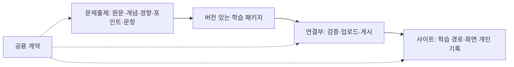

# StudyEZ 구조와 개발 루프 설계

2026-10-26 · 제안 초안 · 현재 동작을 보존하는 리팩토링과 미래 기능 설계를 구분한다.

## 1. 세 책임과 공용 계약

| 영역 | 소유하는 책임 | 기본적으로 읽지 않을 영역 |
|---|---|---|
| 사이트 | 인증, 시간표, 자료 열람, 학습 화면, 개인 상태, 학습 경로 선택 | 프롬프트 전문, PDF 처리, 과거 생성 로그 |
| 문제출제 | 원문 추출, 개념·경향·포인트 분석, 문항 생성, 근거·누락 검수 | 웹 UI, 세션 관리, 운영 DB 구현 |
| 연결부 | 작업 요청/상태, 생성기 실행, 산출물 확인, 업로드, 게시 버전 관리 | 문항의 교육적 판단, 화면 표현 |
| 공용 계약 | 식별자, 스키마, 구조 검증, 버전·호환 규칙 | DB 접속, HTTP 서버 시작, 모델 호출 |

공용 계약은 네 번째 서비스가 아니라 세 영역이 함께 사용하는 작은 라이브러리다. 학습 경로와 복습 선택은 사이트의 도메인 로직으로 둔다. 생성기는 개념 관계와 문항을 만들고, 사용자의 다음 문항을 직접 결정하지 않는다.



## 2. 기존 경로에서 시작하는 목표 구조

대규모 경로 이동 자체는 목표가 아니다. 첫 단계는 아래 소유권을 문서·import 경계·검사로 고정하고 현재 실행 경로를 유지한다.

```text
web/                         사이트 화면 (현재 배포 루트 유지)
server/                      사이트 API / 학습 도메인 / 데이터 저장
quizbank/                    현행 문제은행 처리 + 이후 새 생성 단계
quizgen/                     사용 중인 예습·Anki 처리 및 기존 호환
runner/                      생성 작업 실행·업로드 연결
studyez_contracts/           공유 스키마·순수 검증 (신설 제안)
content/prompts/             출제 프롬프트 정본 (신설 제안)
studyez_llm/                 모델 실행 어댑터
bridge/                     대화 전달·회수 어댑터
spotter/                    별도 제품, 독립 작업 안내·검사
platform/                   실제 공유 세션 코드
docs/changes/<작업ID>/        intent.md / spec.md / plan.md / 검증·배포 결과
docs/architecture/           경계·계약·작업 지도
```

장기적으로 Spotter나 생성기를 별도 저장소로 추출할 수 있지만, 현재 공유 인증·DB·배포 결합부터 확인한다. 내부 폴더 정리만으로 배포 서비스가 늘어나지는 않는다.

### 우선 고칠 실제 결합

- `quizbank/schema.py`, `quizbank/validate.py` 등은 `server.app.bank_validation`을 import한다. 재사용 중인 순수 계약 부분을 `studyez_contracts`로 옮기고 기존 경로는 재수출 어댑터로 호환한다. 서버 전용 정책·DB 작업은 계약 패키지로 넣지 않는다.
- `quizbank/generate.py`는 `web/src/bank/bankPrompt.md`와 강의 범위·전달 지침을 읽는다. 정본을 출제 자산으로 옮기고 웹·확장은 버전과 해시가 있는 생성된 배포 자산을 소비한다. 동등성 비교 없이 문구를 바꾸지 않는다.
- 웹 빌드가 `bridge` ZIP과 프롬프트 JSON을 만든다. 기존 다운로드 동작을 유지하면서 자산 준비를 명시적 단계로 분리한다. 자산이 오래됐거나 누락된 빌드는 실패해야 한다.
- `server/app/routes/bank.py`는 업로드, 관리자 수정, 피드백, 학습, 정답 공개를 함께 포함한다. 외부 URL·응답을 유지하며 책임별 내부 모듈로 나눈다.
- 공통 `CLAUDE.md`에 누적된 강의별 예외는 해당 작업 기록으로 옮기되, 아직 적용되는 제한은 짧은 색인에서 반드시 찾아갈 수 있어야 한다. 기존 지시를 무효화하는 정리로 만들지 않는다.

## 3. 적게 읽고 정확하게 작업하는 규칙

읽기 순서: 짧은 공통 규칙 → 작업 지도에서 영역 선택 → 해당 영역 안내 → 관련 계약 → 변경 파일·검사. 변경이 경계를 넘으면 연결된 소비자만 추가한다.

| 과제 예시 | 시작 범위 | 추가 범위 조건 |
|---|---|---|
| 학습 화면 배치 수정 | web 해당 기능·타입 | API 필드가 변할 때 서버·계약 |
| 다음 문제 선택 수정 | study_engine·선택 API·관련 검사 | 표시 내용이 바뀔 때 웹 |
| 문항 생성 지침 수정 | 출제 프롬프트·해당 단계·실패 예시 | 산출물 구조 변경 시 계약·연결부 |
| 업로드 실패 | runner 업로드·서버 수신·계약 | 생성 파일 자체가 잘못됐을 때 생성기 |
| Spotter 수정 | spotter 안내·코드·관련 서버 경로 | 공용 인증을 바꿀 때 StudyEZ 인증 검사 |

루트 전체 검색은 마지막 수단으로 삼는다. `work/`, `tmp/`, 생성물, 과거 기록은 일반 검색에서 제외하고 필요한 경로만 명시해 읽는다. 검색 제외와 Git 추적 제외는 별개다. 현재 추적되거나 유일한 원본인 자료를 일괄 추적 해제하지 않는다.

문서마다 코드와 같은 숫자·정책을 복제하지 않는다. 계약의 정본은 실행 가능한 스키마/검사, 안내는 위치와 변경 이유를 설명한다. 작업 결과는 짧은 상태·결정·검증·다음 행동으로 남긴다.

토큰 절감은 폴더 수보다 읽기 범위, 변경 영향, 재실행 범위로 측정한다. 화면 수정, 출제 단계 수정, 연결 오류 수정의 대표 과제를 전후 비교하고 모델·과제 난이도·캐시 조건을 함께 기록한다.

## 4. 분리와 보관 정책

| 대상 | 제안 처리 | 확인할 조건 |
|---|---|---|
| Spotter 코드·수동 데이터 | 별도 제품 영역으로 유지, 이후 추출 검토 | 공유 인증·모델·R2·라우트·세션·배포 의존성 |
| bridge | 연결 어댑터로 유지 | 예습·복습·문제 전달·다운로드 사용 여부 |
| 예습 quizgen | 현역 기능으로 유지 | Main 구형 생성 중단과 Pre 기능을 구별 |
| 구 Main 생성 경로 | 호환 영역 지정 후 미사용 부분만 보관 후보 | CLI, 재빌드, Anki, 기존 기록·API 참조 |
| work의 과거 release 사본 | 활성/유일 원본 제외 후 별도 보관 | 실행 프로세스·예약 작업·문서 참조·미커밋 수정 |
| tmp/out/배포 생성물 | 재생성 여부 확인 후 보관 또는 정리 후보 | 재생성 입력·버전·실제 복원 가능성 |
| runs, 자료 매칭, 메모, 수동 응답, 피드백 ledger | 운영 데이터로 보존 | 생성 캐시로 취급하지 않음 |
| docs의 오래된 결정·실패 사례 | 역사 기록으로 이동, 활성 규칙 색인 유지 | 현재 예외 지시의 적용 범위·종료 조건 |

보관은 선택 목록 → 원본/대상 경로 검증 → 복사 → 파일 수·SHA-256 대조 → 복원 시험 → 참조 갱신 → 원위치 정리 순서다. 실제 경로는 구현 전 확정한다. 보관 대상이 운영 러너나 예약 작업에서 사용 중이면 그 항목은 이동하지 않는다. 삭제를 보관의 대체 수단으로 쓰지 않는다.

보관 목록 필드: 원래 경로, 보관 경로, 분류, 보관 이유, 참조 목록, 파일 수, 해시 목록, 검증 시각, 복원 방법, 원위치 정리 여부. 강의 원문·사용자 기록·비밀 설정을 공개 저장소에 올리지 않는다.

## 5. 미래 출제 파이프라인 — 인터페이스 초안

새 방식의 내용 정책은 사용자의 후속 설명 후 확정한다. 아래는 교체 가능한 단계와 검수 단위를 마련하는 제안이다.

```text
26필기 + 족보 → Source Inventory (출처 ID·해시·쪽·범위·읽기 실패)
  ├ Concept Structure: 개념과 포함 관계·선행 관계
  ├ Exam Trends: 족보 연도·교수·문항·개념별 관측 근거
  └ Exam Points: 질문이 요구할 지식·관계·회상 동작
           ↓ 세 결과를 대조·연결하고 충돌을 기록
  Question Blueprint → Questions → Coverage Audit → 보완·재검증
           ↓
  검증 상태가 포함된 Learning Package → 사이트의 Journey Engine
```

세 추출 결과는 독립 파일·버전·근거를 가진다. 최초 추출은 생성 문항을 정답처럼 참고하지 않는다. 연결 단계에서 서로 대조한다. 족보가 없는 개념도 필기 범위에 있으면 유지하며, 경향이 강하다는 이유만으로 범위 밖 개념을 자동 편입하지 않는다. 세 단계의 중복 입력 비용을 줄이기 위해 원문 추출 결과는 재사용하되 교육적 판단 결과를 같은 것으로 합치지 않는다.

### 제안 산출물

| 산출물 | 핵심 필드/의미 |
|---|---|
| source-manifest | source_id, 원본 해시, 자료 종류, 쪽/영역, 범위 제외 이유, 판독 상태 |
| concepts | concept_id, 이름, 포함 관계, 선행 관계, 교차 연결, 근거 |
| exam-trends | trend_id, 연도/교수/족보 문항 식별자, 반복 관측, 관련 concept_id, 불확실성 |
| exam-points | point_id, 관련 개념·경향, 요구하는 회상/적용, 근거, 제외·충돌 상태 |
| questions | question_id, revision, point_ids, 실제 질문/답/채점 단위, 근거, 검토 상태 |
| coverage | 원문 단위↔개념/포인트↔문항↔채점 단위, 누락·제외·불명 상태 |
| learning-package | schema/build 버전, 상위 산출물 해시, 생성/검수 정보, 공개 판단용 상태 |

식별자는 정렬 순서나 표시 이름 변경으로 바꾸지 않는다. 내용 수정은 revision으로 추적하고, 기존 문항과 동일함을 확인하지 못한 경우 학습도를 자동 승계하지 않는다. 추적 정보에는 모델·프롬프트·코드 버전과 실행 시간·토큰을 포함한다.

### ‘빠짐없이’ 검사하는 세 층

1. **추출 범위:** 모든 원문 쪽/표/그림/주석 영역이 검토·제외 사유·판독 불가 중 하나로 기록되는가. 쪽 하나를 인용했다고 그 쪽 전체를 검사한 것으로 세지 않는다.
2. **지식 연결:** 범위 안의 개념·관계·출제 포인트가 각각 연결되었는가. 문항에서 포인트를 거꾸로 만들어 누락 없음으로 판정하지 않는다.
3. **실제 인출:** 포인트가 질문과 채점 단위에서 실제로 요구되는가. 해설에만 등장하거나 질문에 정답이 노출되면 충족으로 세지 않는다.

기계 검사는 ID·참조·순환·형식·집합 누락을 확인한다. 원문 의미의 누락은 별도 검토 단계가 대조한다. 어떤 AI 검수도 원문 전체의 의미적 무누락을 절대 보장하지 않으므로, 미검토·판독 불가·자료 충돌을 숨기지 않는 것이 완료 조건이다.

검수의 독립성은 별도 단계와 입력 제한을 뜻하며, 같은 모델의 공통 오류까지 없어지는 것은 아니다. 생성 단계가 만든 포인트만 검사하는 검수와 원문을 다시 보는 검수를 구분한다.

### Concept Tree 여행

UI는 뿌리 → 가지 → 세부 개념으로 안내하되, 데이터에서는 포함 관계와 학습 선행 관계를 구분한다. 의학 개념은 여러 가지와 연결될 수 있으므로 교차 연결을 별도로 두고, 경로 선택에 필요한 선행 그래프는 순환을 검사한다.

Journey Engine은 현재 위치·탐색한 가지·복습 필요 지점을 개인 상태로 저장한다. 첫 탐색의 문항 순서와 장기 복습 일정은 별도 정책으로 둔다. 재생성된 Concept Tree에 개인 진행도를 무조건 붙이지 않는다. 자유 이동, 가지 해금, 오답 재방문, 족보 빈도 가중치는 후속 결정 사항이다.

현재 서버의 study_engine과 ConceptMap UI를 출발점으로 삼고 전체 폐기하지 않는다. 새 엔진은 기능 선택 장치 뒤에서 시범 강의로 검증하고 기존 풀이로 돌아갈 수 있어야 한다.

### 재실행 비용

입력 해시 + 단계 코드/프롬프트 버전 + 모델 설정 + 계약 버전을 기준으로 재사용 여부를 판단한다. 원문·범위·정책이 바뀌면 영향받는 하위 산출물만 무효화한다. 실패 복구는 성공한 단계를 재사용하며, 생성/수정/검수 횟수와 누적 비용을 초기화하지 않는다. 상한 후에는 미해결 상태로 사람이 판단한다.

## 6. 개발 Process Flow loop

| 단계 | 기록 | 완료·승인 조건 |
|---|---|---|
| Plan | intent.md | 문제, 사용자 효과, 범위, 성공 기준, 미정 사항 |
| Design | spec.md | 책임, 계약, 데이터 보존, 호환성, 수용 기준 |
| Build 준비 | plan.md | 단계별 변경 파일, 검사, 복원 방법, 승인할 범위 |
| Build 실행 | 계획 진행 상태 | 사람이 구체적 계획 승인 후 해당 범위 구현 |
| Test | test-results.md | 명령/환경/결과/미해결 기록; 수정→재검증, 상한 적용 |
| Deploy | release.md | 코드 리뷰, 대상 버전, DB 변경, 배포 순서, 되돌리기; 중요 승인 후 실행 |
| Maintain | incident.md 또는 기존 피드백 ledger | 감지·중복 묶기·분석 → 새 intent 초안으로 연결 |

문서는 작업별로 둔다. 하나의 전역 plan.md에 과거 작업을 계속 누적하지 않는다. 작은 변경은 세 문서를 짧게 쓰고 위험·복잡성에 맞게 검증한다. 승인 기록에는 대상 계획 revision·승인 범위·시각·발언 근거를 남기고 계약/데이터 정책 등 중요한 범위가 변하면 다시 승인한다.

Maintain의 기술 신호 예시: API 실패율, 작업 큐 지연, 러너 생존 신호, 생성 실패, 계약 불일치, 데이터 보존 검사 실패. 감지 시 원문 로그를 무제한 읽는 대신 해당 빌드·작업 ID로 좁힌다. 접수 문구는 증거로 다루고 코드 변경 지시나 사용자 승인으로 취급하지 않는다.

기존 `runner.feedback`와 피드백 개선 채팅/매시간 루프를 재사용하는 방향으로 설계한다. 이번 단계에서 추가 스케줄을 만들지 않는다. 운영 감지의 관측 위치·주기·임계치·실행 환경은 구현 시 확인한다. 새 장애의 분석과 계획 작성은 자동 진행할 수 있지만, 그 사실만으로 운영 배포를 승인받았다고 처리하지 않는다.

## 7. 검증·호환성 수용 기준

- 현행 질문/답/제외 문항과 문항 ID가 구조 정리 전후 동등하다.
- 기존 API의 URL·권한·응답과 기존 CLI 진입점이 유지된다.
- 공유 계약을 import해도 DB·서버·모델 실행이 일어나지 않는다.
- 게시/중복 업로드/실패 후 재개/구버전 읽기가 계약 검사에 포함된다.
- 웹의 정답 공개·평가·개인 수정·복습 기록과 Anki 내보내기를 검증한다.
- 새 경로는 구 데이터 읽기와 학습 상태 보존을 확인하고 단계적으로 켠다.
- 보관 대상은 해시 대조·참조 검사·복원 시험을 통과한다.
- 유지보수 비용 개선은 대표 과제 실측으로 판단한다.

설계 참고: 서비스 분산에는 별도 운영 비용과 경계 설계 비용이 따른다. [Martin Fowler, Monolith First](https://martinfowler.com/bliki/MonolithFirst.html). StudyEZ에 대한 모듈 우선 권고는 로컬 코드 조사에 따른 판단이다.


## 2026-10-26 승인 및 범위 명확화

사용자는 “좋아. 지금 행동은 진행해줘”라고 P0~P2를 승인했고, Process Flow loop는 이번
리팩토링만이 아니라 “이 사이트에 대해” 지속 적용할 것임을 명확히 했다.
따라서 공통 개발 안내·새 작업 생성·승인/검증/리뷰 gate·공개 웹/API 관측과 기존 매시간
피드백 자동화 연결을 구현한다. 운영 배포·DB 변경·강의 재출제·과거 데이터 이동은 하지 않는다.
계획의 P3 이후 기능/자료 이전은 계속 별도 실행 범위다.
