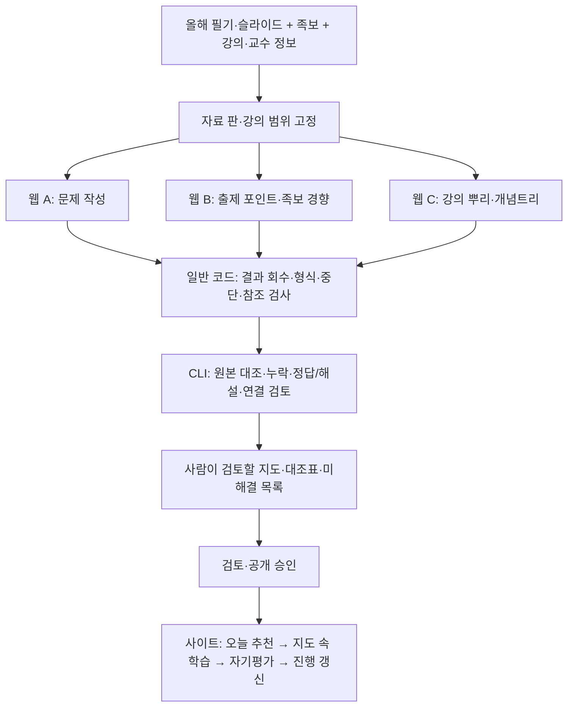

# StudyEZ 콘텐츠 준비 → 학습 파이프라인

2026-10-31 KST. 사용자의 “오케이. 그러면 진행해볼까? 한번 파이프라인을 보여줘봐.”에 따라
웹 중심 작성·코드 후처리·CLI 의미 검증의 흐름을 구체화한다. 이 문서는 설계이며 실제 생성·구현·게시 결과가 아니다.

## 전체 흐름

세 웹 대화는 서로의 결과를 입력받지 않는다. 같은 원본과 동일한 강의 범위는 공유하되 각각 원본에서
작성한다. 대화를 나누는 것은 작성 과정의 독립성을 위한 것이며 서로 다른 모델에 의한 독립 검증을 뜻하지 않는다.
사이트 연결은 후속 구현·검사·출시 절차를 거친 이후의 모습이다.

## Bridge 연결 안정성 — 사용자 후속 지적

사용자의 우려는 탭 동시 실행 자체가 아니라, 웹 결과를 bridge로 연결하는 작업이 세 번 필요해지는
것이다. 각 작업의 실패 확률이 동일한 p이고 독립이라면 한 번에 세 작업 중 하나 이상 실패할 확률은
`1-(1-p)^3`이다. 순차 처리만으로 이 확률은 줄어들지 않는다. 실제 실패율은 측정하지 않았고,
로그인·서비스·확장 연결 같은 공통 원인의 실패는 독립 가정과 다를 수 있다.

2026-10-31 로컬 소스 확인:

- `bridge/background.js`는 서버 저장 확인 전 pending 본문을 세션 저장소에 두고 재전달한다.
  다만 문제은행 pending 키는 웹앱 탭 ID와 강의 ID이며, 포인트/트리 종류·개별 작업 ID를 구분하지 않는다.
  같은 키로 여러 결과를 전달하면 별도 결과로 안전하게 관리된다고 가정할 수 없다.
- `bridge/chatgpt-share.js`에는 실패 시 대기 후 재시도와 공유 실패 전 본문 전달 경로가 있다.
  이것이 포인트/트리 작업의 영속 보관·개별 재개를 제공한다는 뜻은 아니다.
- `web/src/bank/bankBridge.ts`의 현행 수신은 문제은행 완료 표식과 `/bank-response` 계약이며,
  저장 이후 기존 CLI 검수·게시 흐름으로 이어진다. 포인트·트리 초안을 이 경로에 넣지 않는다.
- 실제 운영 확장 버전·실패율·복구 성공률은 이번 읽기 전용 확인에서 검증하지 않았다.

따라서 위 세 갈래는 **목표 파이프라인**이며 현행 bridge로 즉시 실행 가능한 세 종류의 작업 계약이 아니다.
웹 중심 배치를 유지한다면 다음 보강을 구현 계획에 먼저 포함하는 것을 권고한다:

1. 강의·원본 판·작업 종류·작업 ID별로 결과와 상태를 분리하고, 완료 원문을 영속 보관한다.
2. 결과별 저장 확인에 작업 ID와 내용 지문을 사용하고 중복 전송을 중복 처리하지 않는다.
3. 웹 생성 실패와 bridge 전달 실패를 구별한다. 전달만 실패했다면 같은 결과를 다시 보내며 새로 생성하지 않는다.
4. 성공한 작업은 보존하고 실패한 작업만 재개한다. 로그인/서비스 같은 공통 실패에서는 반복 요청을 멈추고 복구 상태를 표시한다.
5. 포인트/트리 초안 수신은 문제은행 게시 경로와 분리한다. 필수 세 결과가 준비돼야 대조 준비 완료로 표시한다.

이 보강은 아직 설계 제안이며 구현하지 않았다. 사용자 승인 전 실제 bridge 확장 작업으로 진행하지 않는다.
현행 bridge만 사용하며 연결 횟수를 유지하는 대안은 웹 문제 작성 1회 + CLI 독립 포인트/뿌리 추출이다.
이 대안은 CLI 사용량이 증가하므로 웹 중심 배치를 대체하는 것으로 자동 결정하지 않는다.

## 단계별 역할과 결과

| 단계 | 담당 | 결과·통과 기준 |
|---|---|---|
| 1. 자료 준비 | 일반 코드 + 범위 확인 | 원본 판·쪽 번호·강의 ID·교수·족보 출처를 고정. 자료 대기는 미학습과 구별 |
| 2A. 문제 작성 | 일반 ChatGPT 웹, 사용자 수동 전송 | 원본 근거를 가진 문제·정답·해설. 다른 두 결과에서 목록을 가져오지 않음 |
| 2B. 포인트·경향 추출 | 별도 웹 대화, 사용자 수동 전송 | 올해 범위의 포인트와 관계·회상 방향, 족보 출처·반복 근거·불확실성. 빈도만으로 중요도를 확정하지 않음 |
| 2C. 뿌리·트리 추출 | 별도 웹 대화, 사용자 수동 전송 | 전체 강의를 대표하는 분류·순서·목적·핵심 질문과 가지. 원본 범위와 족보 중요도 근거를 구별 |
| 3. 결과 회수 | 일반 코드 | 원문 보존, 필수 항목·중복 ID·존재하지 않는 참조·미완료 구간 검사. 형식 통과가 내용 통과를 뜻하지 않음 |
| 4. 대조·연결 | 모델을 호출하는 Codex CLI + 코드 검사 | 포인트별 문제의 실제 충족 여부·정답/해설·원본 누락·트리 위치·학습 순서 검토. 최초 필수 대조를 비용 때문에 생략하지 않음 |
| 5. 검토 | 사용자에게 근거와 함께 제시 | 뿌리 지도, 포인트↔목표/방향↔문제 ID 대조표, 부분 충족·누락·충돌·미검토 목록. 미해결을 자동 통과시키지 않음 |
| 6. 학습 제공 | 승인된 사이트의 일반 코드 | 뼈대→큰 가지→세부 학습. 새 진도와 필요한 복습을 추천하고 답 확인·자기평가 후 다음으로 이동 |

4단계는 문제 ID의 존재뿐 아니라 실제로 무엇을 묻는지 확인한다. 예를 들어 분류를 모두 회상해야 하는
포인트에 단일 예시를 고르는 문항만 있다면 부분 충족일 수 있다. 검토 결과를 기존 문항 수정이나 검수
통과로 자동 반영하지 않는다. 보완 필요는 별도 목록으로 남기며 적용되는 기존 수정·검수 상한을 지킨다.

학습 시에는 매 답변마다 LLM을 호출하지 않는다. 채점·자기평가 계약과 추천 규칙이 확정되고 구현된 후,
기록을 기반으로 진행을 갱신한다. 동일 목표를 여러 방향으로 공부해도 전체 범위는 한 번만 센다.
한 번 공부한 상태와 필수 방향을 회상 가능한 상태를 구별하며 강의별 독립 지도·진행 막대에 반영한다.

## 웹 출력 중단 처리

- 원본 전체를 읽는 범위는 유지하고 출력만 나눈다. 각 결과에 안정적인 ID와 원본 쪽을 남긴다.
- 출력 구간·마지막 ID·남은 범위·완료 상태를 회수한다. “완료”라는 문장만으로 누락 없음으로 판정하지 않는다.
- 코드가 구조적 누락을 찾으면 해당 구간을 사용자에게 제시하고 사용자가 웹에서 이어 받는다. 자동 웹 전송은 하지 않는다.
- 구조적 중단과 의학적 누락을 구분한다. 의학 내용의 수정·추가 검수는 기존 정책과 횟수 안에서 다룬다.
- 미완료·근거 부족은 남겨 두며 완성 결과로 게시하지 않는다. 입력·검수 기준이 같은 결과는 재사용한다.

## 이번 콜린성 약리학(1) 시범

전체 흐름 중 **기존 문제와 새 뿌리·관련 포인트를 대조해 사람이 검토하는 단계까지** 진행하는 범위다.
세부 트리 전체·모든 포인트의 재출제·사이트 연결은 이번 결과로 간주하지 않는다.

1. AI가 정확한 필기·족보 범위와 두 웹 대화의 입력 안내·출력 형식을 준비한다.
2. 사용자가 필기와 관련 족보를 각각의 원본 전용 웹 대화에 첨부한다.
   - 대화 B: 뿌리 관련 출제 포인트·족보 근거.
   - 대화 C: 강의 전체를 보고 고른 뿌리·큰 구조 후보.
   - 이번에는 대화 A로 새 문제은행을 생성하지 않고, 식별한 로컬 기존 69문항을 읽기 전용으로 사용한다.
3. 사용자가 완성 결과를 파일 또는 원문으로 전달하면 AI가 구조 검사와 CLI 원본 대조·의미 연결을 수행한다.
   실제 검토 범위와 미검토를 기록하며, 이 시범을 기존 은행의 추가 의학 검수 차수로 실행하지 않는다.
4. **뿌리 지도 + 기존 문제 연결표 + 부족한 질문/방향 목록 + 첫 학습 순서**를 제시한다.
5. 사용자가 뿌리의 대표성과 학습 순서를 검토한다. 이 검토는 앱 구현·공개 승인을 대신하지 않는다.

족보는 (1)·(2) 합본이므로 올해 (1) 필기를 기준으로 적용 범위를 대조하고 불확실성을 표시한다.
확인한 기존 포인트 색인은 문항에서 유도되었으므로 새 독립 포인트의 기준으로 사용하지 않는다.
기존 원본·문제 ID·학습 기록·개인 수정·검수/재개 기록을 보존한다.

## 시범 완료 기준과 다음 작업

- 원본과 결과의 판·강의 범위·근거 쪽·미확인 범위를 식별할 수 있다.
- 뿌리와 포인트가 기존 문제나 서로의 결과에서 역으로 만들어지지 않았다.
- 뿌리 관련 포인트마다 기존 문항의 충분/부분/미충족/불명확 상태와 이유를 확인할 수 있다.
- 사용자에게 제시할 뿌리·진입 순서와 부족한 부분이 드러나며 기존 자료는 그대로 보존된다.
- 다음 실행 준비물인 **두 웹 대화용 입력 안내와 출력 계약**을 [next-step.md](next-step.md) 및 연결된 요청 문서에 작성했다. 전송·추출은 미실행이다. 첫 결과는 뿌리 파일 한 건을 사용자 수동 전달로 회수하며 bridge 자동 회수 성공으로 표시하지 않는다.
- 사이트 구현 전에는 자기평가·회상 상태, 추천 세부 규칙, 저장·실패 처리와 검사를 포함한 구체 계획을 승인받는다.
