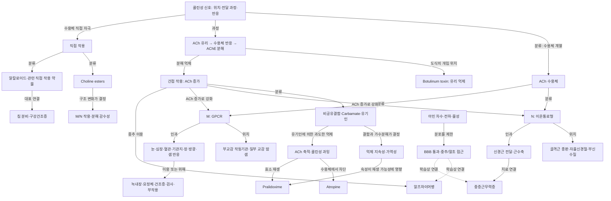

# StudyEZ 콜린성 약리학(1) 콘텐츠 설계 초안
**강의 261002_01 · 원자료에서 다시 구성한 연결 중심 학습 설계**

이 강의를 배운 학습자는 약물명을 나열하는 데서 그치지 않고, **어디의 ACh 신호를 어떤 방법으로 바꾸면 어떤 장기 반응과 치료·독성이 나타나는지** 재구성할 수 있어야 한다. 이를 위해 분류와 큰 연결을 먼저 회상하고, 그 위에서 구조·신호전달·대표 약물·임상 사례를 만나는 순서로 설계했다.

아래 목록은 이번 한 세션에서 만든 **출처 기반 후보 포인트 인벤토리**다. 독립적으로 검증된 추출 결과나 의학 검수 통과본이 아니다. 새 문항 49개는 별도 설계 프로토타입이며, 기존 69문항 은행의 수정·복구·게시물이 아니다. 기존 은행과 사용자가 명시한 `remainingRepairRounds=0` 상태는 변경하지 않았다.

인용의 **L p.번호**는 강의 PDF의 실제 물리 쪽, **E p.번호**는 시험 PDF의 실제 물리 쪽이다.

읽은 범위는 다음과 같다.

- `lecture-text.txt` 전체와 강의 이미지 **p.1–35 전부**.
- `exam-text.txt` 전체와 허용된 시험 이미지 **p.2, 3, 23, 24, 27, 28, 29, 30, 31, 85, 88, 92 전부**.
- `(1)+(2)` 합본 `jokbo_md` 전체. 실제 활용은 이번 강의 본문으로 연결을 확인할 수 있는 부분으로 제한했다.
- 위 자료에서 구조를 형성한 뒤 기존 은행 **69문항 전체의 발문·정답·선지·해설**, 관련 메타데이터와 경고, 두 붙여넣기 파일의 의미 있는 본문을 읽었다. 첫 파일의 거대한 CSS 스타일 부분은 분석 대상에서 제외하고, 같은 줄 뒤에 붙은 개념 라벨과 이후 설명은 읽었다.

PDF의 주석을 더블클릭해야 열리는 내용이나 제공되지 않은 시험 쪽은 확인하지 못했다. 네트워크·외부 의학 문헌·다른 에이전트는 사용하지 않았고 파일 쓰기도 하지 않았다.

---

## 1. 학습자가 재구성해야 할 것과 새 개념도

### 도달할 이해

학습자는 다음 여섯 가지를 연결해서 설명할 수 있어야 한다.

1. **ACh가 작용하는 위치와 수용체**  
   골격근 종판·자율신경절·부신수질의 N 수용체와 부교감 작동기관의 M 수용체를 구분한다. 교감신경 작동기관에도 일부 ACh–M 경로가 있음을 포함한다.

2. **전달 과정과 약물의 개입 위치**  
   ACh의 유리, 수용체 반응, AChE에 의한 작용 종결을 구별하고, 수용체 직접 자극과 분해 억제가 어떻게 다른지 설명한다. 원도식의 유리 억제 위치도 지도에 남긴다.

3. **구조·물성에서 약리 특성으로 이어지는 연결**  
   β-methyl과 carbamoyl 변형을 수용체 선택성·분해 저항성과 연결한다. 아민 차수와 BBB 통과는 직접·간접 작용과 별개의 축으로 다룬다.

4. **수용체에서 장기 반응과 이용으로 이어지는 연결**  
   눈·심장·혈관·기관지·위장관·방광·샘·골격근의 반응을 설명하고, 왜 어떤 반응은 치료에 쓰이며 다른 상황에서는 위해가 되는지 연결한다.

5. **AChE 억제의 방식과 지속성**  
   비공유결합, 가역성 carbamate, 불가역성 유기인을 구분한다. 공유결합이라는 사실만으로 비가역성을 판단하지 않는다.

6. **과잉 신호와 중독 치료의 서로 다른 표적**  
   유기인 노출에서 M·N 관련 소견이 함께 나타나는 이유를 설명하고, atropine의 수용체 차단과 pralidoxime의 효소 재생을 구별한다.

### 새 개념도

**관계 라벨을 읽는 법**

- **분류 관계**는 “무엇의 한 종류인가”를 뜻한다. 예를 들어 carbamate는 간접 작용 약물의 하위 분류다. 이것만으로 임상 용도까지 설명되지는 않는다.
- **인과 관계**는 “무엇이 무엇을 바꾸는가”를 뜻한다. AChE 억제 → ACh 증가 → 수용체 활성 증가가 여기에 해당한다.
- **위치 관계**는 수용체가 어느 전달 부위에 연결되는지를 표시한다. “부교감”이라는 신경계 이름과 “M”이라는 수용체 이름은 같은 분류축이 아니다.
- **선행 관계**는 학습 설계상의 관계다. 정상 분해를 한 번 이해하면 억제 지속성 비교가 쉬워지지만, 정상 반응의 모든 분자 단계를 완벽히 외워야 다음 문항을 풀 수 있다는 뜻은 아니다. 실제 필요한 선행 문항만 아래에 지정했다.

읽기 쉬운 위계로 정리하면 다음과 같다.

| 큰 가지 | 먼저 세울 연결 | 이후 만나는 가지·잎 |
|---|---|---|
| 전달의 자리 | ACh–M/N–위치 | 교감 콜린성 예외, N의 신경근 전달 |
| 개입의 자리 | 유리·수용체·분해는 서로 다른 단계 | botulinum 도식, 직접형·간접형 |
| 직접형 | 두 약물군과 구조–기능 연결 | 네 choline ester, 알칼로이드, BBB |
| 장기와 이용 | 표적 반응이 치료와 위해로 갈라짐 | 축동·분비·배뇨·장운동·기관지 검사 |
| 간접형 | 정상 분해와 억제 지속성의 차이 | 세 억제군, 대표 약물, MG·알츠하이머 |
| 중독과 회복 | ACh 과잉의 발생과 치료 표적 | M/N 소견, 호흡 위험, 차단·재생·aging |

**합성·저장·유리의 범위:** L p.8·18의 도식에는 소포와 ACh 유리, botulinum toxin의 개입 위치가 있다. 이 연결은 효현제 중심 지도에서도 빠뜨리지 않았다. 반면 이번 강의에서 **ACh 합성 억제 약물의 명시적 설명은 확인되지 않았다.** E p.28의 vesamicol 선지와 E p.23의 ChAT 언급을 근거로 합성·저장 약리학 전체를 이번 강의 내용처럼 추가하지 않는다.

---

## 2. 출처 기반 후보 포인트 인벤토리

새 포인트 ID는 `P01–P24`, 새 문항 ID는 `D01–D49`다. 기존 은행의 C·Q·LNK ID와 별개다. 하나의 포인트에 여러 연결이 있어도 모두 별도 문항으로 쪼개지 않았다.

| 포인트 | 층위 | 후보 내용과 연결 | 근거 | 처리 |
|---|---|---|---|---|
| P01 | 뼈대 | ACh 수용체의 두 계열과 신경계별 전달 위치 | L p.5–7 | D01–03 |
| P02 | 뼈대·경계 | 유리–수용체 반응–분해, botulinum 도식의 개입 위치 | L p.8·18 | D04. 합성 억제 상세는 보류 |
| P03 | 뼈대 | 직접형은 수용체, 간접형은 AChE를 표적으로 함 | L p.8 | D05 |
| P04 | 가지 | 직접형의 choline ester와 알칼로이드·관련 약물 | L p.8–11·15 | D06·15 |
| P05 | 뼈대 | 간접형의 세 억제군 | L p.19·22 | D07·34–36 |
| P06 | 뼈대 | 콜린성 효과가 여러 치료 목적과 위해로 연결됨 | L p.4·12·15·23 | D08 |
| P07 | 가지·잎 | β-methyl·carbamoyl, 네 choline ester의 대응 | L p.9–10 | D09–13 |
| P08 | 교차축 | 극성·전하·친수성과 BBB 제한 | L p.9·24 | D14·40–41 |
| P09 | 가지·잎 | 직접형 대표 물질의 M/N 대응 | L p.11·15 | D15·32 |
| P10 | 가지 | 눈의 근육 반응·축동·조절·방수 배출 | L p.12·15–16 | D16·27·30 |
| P11 | 가지·잎 | 심장 효과, M2, Gi/o, Ca·K 경로 | L p.12–13 | D17–19 |
| P12 | 가지·불확실 | NO 확장과 원문의 고용량 M3 수축 설명 | L p.12 | D20, 원문 대조형 |
| P13 | 가지 | 기관지 수축·분비와 methacholine 진단 이용 | L p.12·15 | D21·31·44 |
| P14 | 가지 | 위장관 운동·분비와 bethanechol 이용 | L p.12·15 | D22·31 |
| P15 | 가지·불확실 | 배뇨근 수축·통합 배뇨 반응과 bethanechol | L p.12·15 | D23, 직접 효과 일반화 유보 |
| P16 | 가지·잎 | 샘 분비, 쇼그렌·방사선 후 건조증, 두 약물 | L p.11–12·15·17·29 | D24–26 |
| P17 | 배경·잎 | 녹내장 유형과 비콜린성 치료의 방수 조절 축 | L p.16 | D28–29, 보조 순회 |
| P18 | 가지 | N 수용체 활성에서 근수축, 간접형의 NMJ 이용 | L p.14·23 | D03·37·43 |
| P19 | 가지·잎 | 정상 ACh 가수분해, 억제 결합과 효소 재생 | L p.18–22 | D33–36 |
| P20 | 가지·잎 | 간접형의 MG·진단·알츠하이머 이용 | L p.23–24 | D37–41 |
| P21 | 가지 | 노출·증상군에서 유기인 과잉 기전으로 연결 | L p.19·25·27–28 | D42–44 |
| P22 | 가지·잎 | atropine 차단과 pralidoxime 재생, aging | L p.19·26–28 | D45–47 |
| P23 | 잎·불확실 | 농약·신경작용제·선택적 독성·제한된 안과 용도 | L p.19·23·25 | D48–49, 일부 원문 대조형 |
| P24 | 자료 경계 | 부록·시험 복원·합본 범위·상충 정답 | L p.1·30–35, E p.2–3·27–31·92 | 학습 문항과 출처 판단을 분리 |

### 강의 35쪽 전체의 커버리지

**열람했다는 사실은 그 쪽의 모든 사실을 문항으로 만들었다는 뜻이 아니다.** 아래 표는 학습 목표, 배경, 자료 안내, 부록을 구분한 기록이다.

| 물리 쪽 | 성격·확인 내용 | 학습상 처리 |
|---:|---|---|
| 1 | 필기 안내, 색상·스탬프·부록 설명 | 출처 해석에 사용, 암기 대상 제외 |
| 2 | 약물–임상응용 요약표 | 본문과 대조. 표에만 있는 이름은 낮은 우선순위 |
| 3 | 강의 표지와 수업 흐름 | 범위 확인 |
| 4 | 다섯 학습목표 | 구조·문항 범위의 기준 |
| 5 | ACh와 두 콜린수용체 | P01 |
| 6 | 체성·교감·부교감 전달 위치와 예외 | P01, 시험 충돌 확인 |
| 7 | N 이온통로와 M GPCR | P01·18 |
| 8 | 직접·간접 작용, 말단 도식 | P02–04 |
| 9 | choline ester 구조·분해·M/N·BBB | P07–08 |
| 10 | 구조 변형 부연 설명 | P07 |
| 11 | muscarine·pilocarpine·nicotine·lobeline | P04·09·16 |
| 12 | 장기별 효과 표 | P06·10–16 |
| 13 | SA node M2와 신호전달 | P11 |
| 14 | NMJ N 활성–근수축, 올해 넘어간 표시 | P18. 시험 유무와 별개로 첫 학습에 포함 |
| 15 | 직접형 임상응용·주의·비교 | P09–16 |
| 16 | 녹내장 배경과 여러 치료군 | P10·17. 올해 3번 중심 설명 표시 반영 |
| 17 | 쇼그렌 증후군·침분비 치료 | P16 |
| 18 | AChE 정상 반응과 말단 도식 | P02·19 |
| 19 | 세 억제군·결합·지속시간·aging | P05·19·21–22 |
| 20 | 전년도 보충: 정상·비공유·carbamate | P19 보충, 올해 설명과 구분 |
| 21 | 전년도 보충: carbamate 비교·유기인 | P19 보충 |
| 22 | 분해속도·인산화·aging 재정리 | P05·19·22 |
| 23 | 간접형 임상응용·대표 약물·독성 | P20·23. 더블클릭 내용은 미확인 |
| 24 | 3차·4차 아민 구조와 BBB | P08·20 |
| 25 | Sarin·VX 실제 사용 사례 | P21·23. 사건 세부 암기 제외 |
| 26 | AChE 재생 약물·친핵체·도식 | P22. 명명·동의어 문제는 유보 |
| 27 | 농약 노출 Case 1 | P21–22. 단일 약물 답으로 과도하게 축소하지 않음 |
| 28 | atropine 시작 후 효소 재생 Case 1-1 | P22 |
| 29 | pilocarpine 기전 Case 2 | P16. 질환·처방 약물은 발문에서 제공됨 |
| 30 | 참고서적 | 참고 안내, 문항 제외 |
| 31 | 2025 시험 부록 | 해당 본문 연결만 활용, (2) 문항 제외 |
| 32 | 2023 시험 부록 | 전달 과정 선지·정답 충돌 분석 |
| 33 | 2022·2021 시험 부록 | 구조 그림·BBB·건조증·중독 연결 |
| 34 | 2020·2019 시험 부록 | 다른 교수 자료라는 안내 유지 |
| 35 | 2019 시험 부록 후속 | 중독·길항제 문항의 범위 구분 |

### 첫 학습에는 남기되 별도 회상 문항을 보류한 잎

| 내용 | 처리 이유 |
|---|---|
| McN-A-343·oxotremorine | L p.2 요약표에 이름이 있으나 본문 설명이 제한적. 계열표에서 한 번 읽고 상세 기전 문항은 보류 |
| Ambenonium·Demecarium·Carbaryl | L p.19–20의 목록은 읽되, 특히 Ambenonium 분류는 기존 경고와 관련되어 확정 채점 보류 |
| Donepezil·rivastigmine·galantamine 증량 수치 | L p.23에 존재. 이번 이해 목표에 필요한 연결보다 처방 수치 비중이 커서 별도 암기 보류 |
| L p.15의 독성 처치 용량·세부 투여 경로 | 원문 표현과 기존 은행의 외부 정정 이력이 달라 새 확정 문항에서 제외 |
| HI-6·Asoxime의 동의어 취급 | L p.26의 나열과 기존 경고가 상충. pralidoxime의 동의어 정답으로 사용하지 않음 |
| 사건 연도·사망자 수·사진 속 세부 | 유기인 위험의 맥락으로 읽고 회상 평가 제외 |
| 부록의 산동제·과민성 방광 길항제·신경근 차단제 상세 | 콜린성 약리학(2) 또는 다른 강의 범위. 이번 단원 완결을 위해 가져오지 않음 |

---

## 3. 시험이 실제로 검사한 연결

시험 근거는 **이 연결이 복원 문항에 등장했다는 관찰**이다. 정확한 출제 확률이나 빈도 추정으로 바꾸지 않는다. 합본 MD의 “19문항”, “반복률 0%”, 가중치 권고도 이번 강의의 출제율로 채택하지 않았다.

| 확인한 시험 자리 | 발문이 주는 것 | 실제 회상·판별 대상 | 오답이 왜곡하는 연결·한계 |
|---|---|---|---|
| E p.27, 2025 17번 | 분해될 수 있음 + N에 결합하지 않음 | 두 특성의 교집합 → methacholine | ACh는 N 작용도 있음. Bethanechol은 분해 저항성 축에서 다름 |
| E p.27, 2025 20번 | 녹내장 약 사용과 배뇨·배변·분비 증상 | 증상군–약물–신경–수용체의 일치 | Carbachol을 M에 연결하는 선지가 맞는 맥락. Carbachol이 M에만 작용한다는 뜻은 아님 |
| E p.27, 2025 25번 | 후보 약물명 | BBB 통과 비교 | Physostigmine과 두 4차 약물의 구별은 L p.23–24에서 확인. 모든 후보의 정확한 상대 순위까지 강의로 입증되지는 않음 |
| E p.28, 2022 39번 | 약물–성질 명제 | Methacholine BBB, bethanechol N 작용, cevimeline 침분비 등의 정오 | 서로 다른 축을 섞은 문항. 한 명제의 등장으로 계열 전체의 중요도를 동일하게 올리지 않음 |
| E p.28, 2022 42번 | 실제 구조 그림 | 구조 인식 → 수용체·BBB·분해 특성 | 그림은 β-methyl이 없는 carbamoylcholine으로 L p.9–10의 carbachol과 대응. 정답표 ②만과 강의 부록 수정 메모가 불일치 |
| E p.28, 2022 65번 | 약물–용도 연결 | Bethanechol과 carbachol의 용도 구별, pilocarpine–쇼그렌 연결 | 같은 콜린성 약물이라고 안과·방광 용도를 교환하면 안 됨 |
| E p.28–29, 2021 24·25번 | 농부의 과잉 증상 또는 눈·입 건조 | 중독에서 차단 약물 선택, 건조증에서 분비 촉진 약물 선택 | 질환명 암기와 증상에서 약리 방향을 정하는 일은 구별해야 함 |
| E p.31, 2023 15번 | 쇼그렌·pilocarpine 처방 | 약물 → 콜린수용체 작동 기전 | 쇼그렌 진단이나 약물 선택은 이미 제공됨 |
| E p.31, 2023 16번 | 녹내장 약과 설사·침분비 | 증상–약물–수용체 대응 | Neostigmine을 직접 N 작용제처럼 읽지 않도록 구별 |
| E p.29, 2020 26번 | 여러 억제제와 pralidoxime | 억제와 재생의 방향 차이 | 같은 AChE 관련 약물이라는 표면적 유사성이 오답 유도 |
| E p.30, 2019 59번 | 단시간 효과·후보 약물 | Edrophonium과 짧은 작용의 연결 | “5–15분”과 강의 표의 “2–10분”을 정확히 같은 수치로 통합하지 않음 |
| E p.85, 2025 독성 약리 15번 | 농부·호흡 저하·과다 분비 | 과잉 상황에서 더 자극하는 약물의 부적절성 | 다른 강의에 실린 연결이며 선지 하나가 미복원. 완전한 독립 검증 문항으로 쓰지 않음 |

두 항목은 특히 정답표를 그대로 지식으로 바꾸면 안 된다.

- **2023 14번:** E p.28의 정답표는 ④를 지시하지만, “교감 작동세포에 M 수용체가 없다”는 문장은 L p.6의 일부 땀샘 ACh–M 도식과 충돌한다. Vesamicol·botulinum·분해효소 선지는 서로 다른 전달 단계를 바꾸어 놓는 방식이다. 이번 자료만으로 전체 문항의 정답을 새로 확정하지 않는다.
- **2022 79번:** E p.28은 여러 수용체 중 가장 빠른 반응을 묻는다. 이것을 N 수용체 자체가 출제된 증거로 바꾸지 않는다. N/M 기전은 L p.7·14에 근거하여 구조적 학습 대상으로 포함한다.

---

## 4. 연결 질문과 답: 별도 설계 프로토타입 49문항

### 사용·채점 원칙

학생 화면에는 **ID와 질문만** 보인다. 아래의 답·관계 분석·출처는 교사용 설계 정보다. 가지 제목이나 관계 설명을 문제 위에 함께 띄워 답을 암시하지 않는다.

- **검사**는 실제로 답해야 하는 연결이다.
- **제공**은 발문이 이미 알려주는 내용이다. 여기에 적힌 사실을 회상했다고 계산하지 않는다.
- **선행**은 풀이에 실질적으로 도움이 되는 최소 문항이다. 통과 조건이나 잠금 조건이 아니다.
- `—`는 별도 선행 문항이 필요 없다는 뜻이다.
- 모든 문항은 **정확성 추가 검토 전 초안**이다. `†`는 원문 단순화·기존 의학적 이견 때문에 특히 **원문 설명을 구별하는 답**으로만 사용할 후보이며, 보편적 의학 명제의 확정 채점을 보류한다.

### 가지별 구조·시험·임상 근거

각 문항은 해당 가지의 세 근거를 상속한다. 개별 예외는 문항 뒤에 따로 적었다.

| 가지·문항 | 구조적 근거 | 시험 근거 | 임상적 근거 |
|---|---|---|---|
| A · D01–08 | L p.4–8·18–19·23. 이후 약물 설명의 자리와 분류를 형성 | E p.27–31에서 여러 연결이 사용되지만 D01–08 전체의 직접 출제를 뜻하지 않음 | 표적이 다른 약물을 혼동하지 않게 하는 **강의 기반 추론** |
| B · D09–15 | L p.9–11. 구조·기능·물성을 구분 | 2025 17번, 2022 39·42번의 특성·구조 판별 | 선택성·지속성·접근 부위를 이해하는 **강의 기반 추론** |
| C · D16–32 | L p.12–17·29. 장기 반응에서 이용과 위해로 연결 | E p.27–31의 carbachol·건조증·용도 대응. 모든 장기 세부의 직접 출제는 미확인 | 진단·치료·주의가 L p.15–17에 명시. 기전으로의 연결은 **강의 기반 추론** |
| D · D33–41 | L p.18–24. 정상 종결–억제 지속성–치료 부위 | E p.27의 BBB, p.29의 억제/재생, p.30의 단시간 약물 | MG·알츠하이머·진단 용도가 L p.23에 명시. 현재 진료 표준 판단은 제외 |
| E · D42–49 | L p.19·23·25–28. 과잉 신호–증상–차단/재생 | E p.28–30의 중독, p.29의 기전 구별, p.85의 위해 선택 | 올해 강의 사례와 호흡 위험이 직접 근거. 완전한 임상 처치 지침으로 확장하지 않음 |

### A. 큰 연결을 먼저 세우는 질문

| ID | 학생에게 제시할 질문 | 간결한 답 | 검사 / 제공 | 선행 | 물리 쪽 |
|---|---|---|---|---|---|
| D01 | Acetylcholine을 받는 콜린수용체의 두 주요 계열은 무엇인가? | Muscarinic(M), nicotinic(N). | 검사: ACh → 수용체 계열. 제공: 전달물질 | — | L p.5·7 |
| D02 | 골격근 종판, 자율신경절·부신수질, 부교감 절후 작동기관에서 각각 어떤 전달물질–수용체 조합을 쓰는가? 일반적 교감 절후 경로와 일부 땀샘도 대비하라. | 앞의 두 부위는 ACh–N, 부교감 작동기관은 ACh–M. 일반적 교감 절후는 NE–아드레날린성, 일부 땀샘은 ACh–M. | 검사: 위치 → 조합과 예외. 제공: 위치 목록 | D01 | L p.5–6 |
| D03 | N 수용체와 M 수용체는 신호를 전달하는 방식이 어떻게 다른가? 이 중 골격근에서 탈분극과 수축으로 이어지는 계열은 어느 쪽인가? | N은 ligand-gated ion channel, M은 GPCR. 골격근에서는 N 활성 → 이온 흐름·탈분극 → 활동전위·수축으로 연결된다. | 검사: 계열 → 기전·근육 연결. 제공: 두 계열 | D01 | L p.7·14 |
| D04 | 신경말단에서 ACh가 유리된 뒤 반응이 끝나기까지의 큰 흐름을 설명하라. Botulinum toxin이 표시된 개입 위치는 수용체 자극이나 ACh 분해와 어떻게 다른가? | 유리된 ACh가 수용체에 작용하고 AChE 분해로 작용이 종결된다. Botulinum toxin은 도식에서 유리 단계에 개입한다. | 검사: 전달 단계 구분. 제공: ACh 유리 이후라는 출발점·물질명 | — | L p.8·18 |
| D05 | 콜린성 반응을 강화하는 직접형과 간접형 약물은 각각 무엇을 표적으로 삼으며, 간접형은 왜 ACh 반응을 늘리는가? | 직접형은 수용체에 결합한다. 간접형은 AChE를 억제하여 ACh 분해를 줄이고 양을 늘린다. | 검사: 작용 방식 → 표적·결과. 제공: 강화 방향 | D04 | L p.8 |
| D06 | 직접형 콜린수용체 흥분제의 주요 화합물군 두 가지와 각 군의 예를 하나씩 말하라. | Choline ester: 예를 들어 bethanechol. 알칼로이드군: 예를 들어 pilocarpine. | 검사: 직접형 → 하위군·예. 제공: 직접형 범위 | D05 | L p.8–11 |
| D07 | AChE 억제제를 결합·가역성에 따라 나누는 큰 세 군은 무엇인가? | 비공유결합 제제, 가역성 carbamate, 불가역성 유기인 제제. | 검사: 간접형 → 세 하위군. 제공: 분류 기준 | D05 | L p.19 |
| D08 | 콜린성 반응을 이용하는 치료·진단 목적을 눈, 분비샘, 장·방광, 신경근이음부, 중추로 나누어 하나씩 연결하라. | 눈: 축동·안압 감소. 샘: 건조증의 분비 촉진. 장·방광: 운동·배출 개선. NMJ: MG 전달 개선. 중추: 알츠하이머 치료 용도. | 검사: 작용 부위 → 이용의 큰 갈래. 제공: 부위 목록, 약물명은 제공하지 않음 | — | L p.12·15·23 |

D02는 다섯 위치를 하나의 **분포 지도**로 회상한다. 처음에는 빈 도식에 배치해도 된다. D08 역시 약물명·세부 경로까지 한꺼번에 요구하지 않는 입구 질문이다.

### B. 구조·물성·대표 직접형 약물

| ID | 학생에게 제시할 질문 | 간결한 답 | 검사 / 제공 | 선행 | 물리 쪽 |
|---|---|---|---|---|---|
| D09 | ACh 유사 약물의 구조를 바꿀 때, 수용체 작용과 체내 분해에서 각각 어떤 특성을 조절하려 하는가? | M/N 작용의 선택성과 cholinesterase 분해 감수성·작용 지속성을 조절한다. | 검사: 구조 변형 → 기능적 목적. 제공: 두 평가 축 | — | L p.9–10 |
| D10 | Methacholine, carbachol, bethanechol은 ACh 기본형에 어떤 구조 변화가 생긴 약물인가? | Methacholine: β-methyl. Carbachol: acetyl 대신 carbamoyl. Bethanechol: 두 변화 모두. | 검사: 약물 → 구조. 제공: 기본형 | D09 | L p.9–10 |
| D11 | Choline ester에 β-methyl기가 추가되면 N 작용과 AChE·혈청 BuChE에 의한 분해는 어떻게 달라지는가? | N 작용이 크게 감소한다. AChE 가수분해는 느려지고 BuChE에 의한 분해는 억제된다. | 검사: 변형 → 선택성·분해. 제공: 변형과 평가 대상 | D09 | L p.9–10 |
| D12 | Carbachol과 bethanechol의 분해 저항성을 공통으로 설명하는 구조는 무엇이며, AChE 가수분해에 어떤 영향을 주는가? | Carbamoyl/carbamic acid ester 구조이며 가수분해를 매우 느리게 한다. | 검사: 공통 구조 → 분해. 제공: 두 약물·분해 저항성 | D10 | L p.9–10 |
| D13 | ACh, methacholine, carbachol, bethanechol을 M/N 작용과 분해 감수성 두 축으로 비교하라. “분해될 수 있으나 N 작용은 없는” 약물은 어느 것인가? | ACh: M/N·쉽게 분해. Methacholine: M 선택성·느린 분해. Carbachol: M/N·분해 저항. Bethanechol: M 선택성·분해 저항. 제시 조건은 methacholine. | 검사: 네 약물의 동일 축 비교·교집합 식별. 제공: 비교 축 | D11·D12 | L p.9–10; E p.27–28 |
| D14 | Methacholine을 포함한 choline ester가 BBB를 잘 통과하지 못하는 이유는 무엇인가? | 강한 극성·양전하·친수성이 막 통과를 제한하기 때문이다. | 검사: 물성 → 접근 제한. 제공: 약물군·통과 제한 | — | L p.9–10 |
| D15 | Muscarine·pilocarpine·cevimeline과 nicotine·lobeline을 주된 콜린수용체 작용으로 나누어라. | 앞의 군은 M, 뒤의 군은 N 작용으로 연결한다. | 검사: 약물 → 수용체군. 제공: 약물명 | D01 | L p.11·15 |

D13의 전체 비교표를 외우기 전에 D09로 **비교할 축이 존재한다는 것**을 먼저 묻는다. 구조를 보고 약물명을 맞히는 연습은 D10·13의 후속 변형으로 사용할 수 있지만, 실제 그림을 제시하지 않은 문항을 “그림 식별 완료”로 계산하지 않는다.

### C. 장기 반응에서 이용과 위해로

| ID | 학생에게 제시할 질문 | 간결한 답 | 검사 / 제공 | 선행 | 물리 쪽 |
|---|---|---|---|---|---|
| D16 | 눈의 M 작용에서 동공조임근과 모양체근의 반응은 각각 어떤 동공·조절 변화로 이어지는가? | 동공조임근 수축 → 축동. 모양체근 수축 → 근거리 조절. | 검사: 근육 반응 → 기능. 제공: 장기·수용체군·근육명 | — | L p.12·16 |
| D17† | 콜린성 자극이 심장의 박동수·전도·수축력에 미치는 방향은 무엇이며, SA node의 박동수 감소를 매개하는 M 아형은 무엇인가? | 원문은 박동수·AV 전도속도·수축력 감소를 제시한다. SA node의 아형은 M2. 심실 효과의 범위는 추가 확인 대상이다. | 검사: 장기 → 효과·아형. 제공: 효과의 평가 항목 | — | L p.12–13 |
| D18 | SA node에서 ACh가 심박수를 낮추는 과정을 cAMP–Ca 경로와 K 통로 경로로 나누어 설명하라. | M2–Gi/o → adenylyl cyclase 억제 → cAMP 감소 → Ca 통로 이용률 감소. 별도로 K 통로 개방 → 탈분극 지연. 두 경로가 박동수 감소로 연결된다. | 검사: 표적에서 결과까지의 두 경로. 제공: SA node·최종 효과·경로 구분 | D17 | L p.13 |
| D19 | M 수용체 아형을 Gq군과 Gi군으로 나누면 어떻게 되는가? | M1·3·5는 Gq, M2·4는 Gi 계열. | 검사: 아형 → 신호군. 제공: 분류 기준 | — | L p.13 |
| D20† | 혈관 효과 표의 NO 관련 확장과 고용량 M3 관련 수축은 어떤 서로 다른 연결로 설명되어 있는가? | NO → 혈관확장. 원문의 고용량 설명은 M3–Gq–IP3–Ca 증가 → 평활근 수축. 고용량만으로 생체 순반응을 확정하는 답은 보류한다. | 검사: 상반된 두 설명의 구별. 제공: 두 반응·조건 | D19 | L p.12 |
| D21 | 기관지에서 콜린성 자극이 일으키는 두 반응은 무엇이며, 그 반응을 과민성 진단에 이용하는 약물은 무엇인가? 치료 목적인가? | 평활근 수축·분비 증가. Methacholine을 과민성 진단에 이용하며 치료 목적으로 제시되지 않는다. | 검사: 장기 효과 → 진단 이용·약물. 제공: 장기·검사 목적 | — | L p.12·15 |
| D22 | 장에서 M 자극이 운동·조임근·위액 분비에 미치는 방향과, 장운동 저하에 연결되는 대표 직접형 약물은 무엇인가? | 운동 증가·조임근 이완·위액 분비 증가. Bethanechol이 수술 후·신경성 창자막힘증 용도로 제시된다. | 검사: 장기 반응 → 이용·약물. 제공: 장기·평가 항목 | — | L p.12·15 |
| D23† | 방광에서 배뇨를 촉진하는 반응과 그 목적에 사용하는 대표 직접형 약물을 연결하라. | 배뇨근 수축과 출구 이완을 포함한 배뇨 촉진 반응 → bethanechol. 모든 출구 반응을 직접 M 효과로 일반화하지 않는다. | 검사: 배뇨 반응 → 약물. 제공: 치료 목적 | — | L p.12·15 |
| D24 | 샘 분비를 늘리는 콜린성 반응은 어떤 외분비액에서 나타나는가? 쇼그렌·두경부 방사선 후 구강건조증에는 어떤 직접형 약물을 연결하는가? | 땀·눈물·침·코인두 분비 증가. Pilocarpine과 cevimeline을 건조증 치료에 연결하며, 방사선 후 용도는 pilocarpine이 명시된다. | 검사: 샘 효과·원인 상황 → 약물. 제공: 질환·노출 원인 | — | L p.11–12·15·17 |
| D25 | 쇼그렌 증후군 환자에게 pilocarpine을 처방했다. 침 분비를 늘리는 약물 작용을 신경계와 수용체 수준에서 설명하라. | 부교감 작동기관의 M 수용체를 직접 자극하여 침 분비를 촉진한다. | 검사: 주어진 약물 → 표적·효과. 제공: 진단·약물 선택 | D01 | L p.29 |
| D26† | 구강건조증 치료 약물 비교표에서 cevimeline은 pilocarpine과 비교해 어떤 두 특성으로 제시되는가? | 원문은 부작용이 적고 작용시간이 길다고 제시한다. 보편적 임상 우월성의 확정 답으로 사용하지 않는다. | 검사: 약물 → 원문 비교 특성. 제공: 비교 대상·용도 | — | L p.15 |
| D27 | Carbachol이 녹내장에서 안압을 낮추는 연결을 근육 반응에서 방수 변화까지 설명하라. | 모양체근·동공조임근 수축과 축동 → 방수 배출 증가 → 안압 감소. | 검사: 약물 → 중간 기전 → 결과. 제공: 약물·적응증·결과 | D16 | L p.12·15–16 |
| D28 | 개방각과 폐쇄각 녹내장은 방수 배출 문제의 진행과 증상 발현에서 어떻게 대비되는가? | 원문에서 개방각은 점진적 배출구 손상·서서히 진행, 폐쇄각은 급속한 안압 상승과 심한 안통·두통·오심·구토 등으로 대비된다. | 검사: 질환 유형 → 시간 경과·증상. 제공: 두 유형 | — | L p.16 |
| D29† | 안압을 낮추는 방법을 방수 생성 감소와 배출 증가로 나누어라. Prostaglandin 유사체, α2 작동제, 탄산탈수소효소 억제제를 각각 연결하라. | Prostaglandin 유사체는 배출 증가. α2 작동제는 생성 억제. 탄산탈수소효소 억제제는 중탄산염 생성 억제를 통해 방수 생성을 줄이는 축. | 검사: 치료군 → 방수 조절. 제공: 두 조절 축·약물군 | — | L p.16 |
| D30† | ACh chloride의 안과적 이용은 무엇이며, 빠른 분해라는 성질과 함께 기억할 때 무엇을 구별해야 하는가? | 안과수술 시 국소 축동 용도. 이를 지속적인 전신 치료 용도와 구별한다. 정확한 투여 경로는 원문 확인 전 채점하지 않는다. | 검사: 약물 → 이용·작용 범위 구분. 제공: 약물명·빠른 분해 | D13 | L p.9·15 |
| D31 | 직접형 콜린성 자극이 악화시킬 수 있는 기존 질환 두 가지를 호흡기·위장관 기전과 연결하라. | 천식: 기관지 수축·분비 증가. 위궤양: 위산 분비 증가. | 검사: 장기 반응 → 위해 상황. 제공: 두 장기 범주, 질환명은 제공하지 않음 | D21·D22 | L p.12·15 |
| D32 | Muscarine과 nicotine은 각각 어떤 대표 함유원과 연결되는가? Muscarine을 치료용 약물 목록과 구별해야 하는 이유는 무엇인가? | Muscarine–독버섯, nicotine–담배. Muscarine은 중독 물질로 제시되며 치료제로 쓰이지 않는다고 설명된다. | 검사: 물질 → 출처·용도 경계. 제공: 물질명 | — | L p.15 |

D18에서 K 통로 개방을 cAMP 감소의 뒤에 반드시 놓는 단일 직렬 사슬을 강제하지 않는다. L p.13은 βγ 관련 부가 경로도 표시한다.

D24는 분비액 네 이름과 질환–약물 연결을 부분 채점한다. 목록 하나가 빠졌다고 치료 연결까지 실패 처리하지 않는다. D28–29는 올해 설명 비중이 제한된 배경 가지다. 첫 순회에는 포함하되 초기 반복량은 낮춘다.

### D. 분해 억제의 지속성과 치료 부위

| ID | 학생에게 제시할 질문 | 간결한 답 | 검사 / 제공 | 선행 | 물리 쪽 |
|---|---|---|---|---|---|
| D33 | AChE가 ACh의 작용을 끝내고 다시 사용 가능한 효소로 돌아오는 과정을 설명하라. Choline 유리 뒤 효소에는 무엇이 남는가? | ACh 결합 → choline 유리와 acetyl-AChE 형성 → 가수분해로 acetate 방출·AChE 재생. | 검사: 정상 반응의 중간체·재생. 제공: 효소·기질·첫 사건 | D04 | L p.18·22 |
| D34 | 비공유결합제, carbamate, 유기인 제제의 AChE 결합과 효소 회복은 어떻게 다른가? | 비공유결합은 정전기적·수소결합. Carbamate는 Ser 공유결합 후 느린 가수분해로 회복. 유기인은 인산화된 안정적 결합과 aging으로 회복이 매우 어렵다. | 검사: 분류 → 결합·회복. 제공: 세 분류 | D07·D33 | L p.19–22 |
| D35 | Edrophonium, neostigmine·physostigmine·pyridostigmine, echothiophate·sarin·soman·VX를 AChE 억제 방식으로 분류하라. | 각각 비공유결합, 가역성 carbamate, 불가역성 유기인. | 검사: 약물 → 계열. 제공: 이름, 결합 방식은 제공하지 않음 | D07 | L p.19·23 |
| D36 | Carbamate가 공유결합을 하는데도 가역적일 수 있는 이유와, 유기인에서 aging이 억제를 강화하는 이유는 무엇인가? | Carbamate 결합은 느리지만 가수분해된다. 유기인에서는 aging으로 인–효소 결합이 더 안정해진다. | 검사: 결합 → 가역성 판단·지속 원인. 제공: 비교 상황 | D34 | L p.19–22 |
| D37 | 중증근무력증의 신경근 전달을 개선하는 데 AChE 억제를 연결하는 이유는 무엇인가? 대표 약물을 말하고 bethanechol과 작용 범위를 대비하라. | ACh 분해 감소 → NMJ ACh 증가 → N 활성 증가. Neostigmine·pyridostigmine을 대표로 연결. M 선택적 bethanechol은 이 NMJ 연결을 대신하지 않는다. | 검사: 질환 → 기전·약물·범위 비교. 제공: 질환·비교 약물 | D03·D05·D13 | L p.9·23–24 |
| D38 | 중증근무력증 진단 용도로 제시되는 짧은 작용 AChE 억제제는 무엇인가? 치료용 약물 선택과 구별할 점은 무엇인가? | Edrophonium. 진단 목적의 짧은 반응과 지속적 증상 개선 용도를 구별하며, 현재 진단 표준이라고 확장하지 않는다. | 검사: 진단 목적 → 약물·용도 구별. 제공: 질환·짧은 작용 | — | L p.23 |
| D39† | Donepezil·rivastigmine·galantamine은 어떤 질환의 치료 용도로 연결되는가? Tacrine에는 어떤 안전성 문제가 기재되어 있는가? | 알츠하이머병. Tacrine은 간기능 이상으로 사용 중지되었다고 표에 기재된다. | 검사: 약물 → 질환·안전성. 제공: 약물명 | — | L p.23 |
| D40 | Physostigmine, neostigmine, edrophonium의 아민 차수와 BBB 통과를 연결하고 그 물성 차이를 설명하라. | Physostigmine은 3차·BBB 통과 가능. Neostigmine·edrophonium은 4차·양전하·수용성으로 통과 제한. | 검사: 약물 → 구조적 분류·물성·접근. 제공: 약물명 | — | L p.23–24 |
| D41 | 중증근무력증 치료에서 약물이 BBB를 잘 통과하지 못하는 것이 반드시 불리하지 않은 이유는 무엇인가? | 치료 표적이 말초 NMJ이므로 중추에 도달할 필요가 없기 때문이다. | 검사: 치료 위치 → 분포 특성의 의미. 제공: 질환·BBB 제한 | D37·D40 | L p.24 |

D34–36은 정상 반응의 모든 결합 부위 이름을 선수 암기로 요구하지 않는다. D39에서는 “BBB를 통과한다”와 “어떤 중추 질환에 사용한다”를 별도 연결로 채점한다.

### E. 과잉 신호·중독·재생

| ID | 학생에게 제시할 질문 | 간결한 답 | 검사 / 제공 | 선행 | 물리 쪽 |
|---|---|---|---|---|---|
| D42 | 농약 노출 후 축동·다량의 기관지 분비·서맥·발한·복통·근섬유연축과 호흡곤란이 나타났다. 어떤 중독 계열과 공통 기전을 의심하는가? | 유기인 AChE 억제제 중독. AChE 억제로 ACh가 축적되어 콜린성 신호가 과해지는 기전. | 검사: 노출·증상 → 원인 계열·기전. 제공: 소견, 진단은 제공하지 않음 | D05 | L p.19·27–28 |
| D43 | 한 환자에게 축동·분비 증가와 근섬유연축이 함께 나타난다. 두 종류의 소견을 수용체와 연결하고 공통 원인을 설명하라. | 앞 소견은 M, 근섬유연축은 골격근 N 연결. AChE 억제에 따른 ACh 과잉이 두 계열을 함께 자극한다. | 검사: 혼합 소견 → 수용체·공통 원인. 제공: 증상, 원인 계열은 제공하지 않음 | D02·D05 | L p.12·14·23·27 |
| D44 | 유기인에 의한 콜린성 과잉이 호흡을 위협하는 장기 반응을 두 가지 말하라. | 기관지 평활근 수축과 기관지 분비 증가. | 검사: 과잉 기전 → 호흡 위해. 제공: 중독 계열·위험 장기 | D21 | L p.12·19·27 |
| D45 | 유기인 중독에서 atropine과 pralidoxime은 각각 어느 수준에 개입하는가? 한 약물의 작용으로 다른 역할까지 해결했다고 볼 수 없는 이유는 무엇인가? | Atropine은 M 수용체 작용 차단, pralidoxime은 억제된 AChE 재생. 수용체 차단과 효소 회복은 서로 다른 표적이다. | 검사: 약물 → 표적·역할 차이. 제공: 중독·두 약물 | D05 | L p.26–28 |
| D46 | 유기인 중독 환자에게 기도 확보와 atropine 투여를 시작했다. 억제된 AChE의 회복을 목표로 추가할 약물은 무엇이며, neostigmine을 그 자리에 선택하면 어떤 방향을 혼동하는가? | Pralidoxime. Neostigmine은 AChE 억제제이므로 억제와 재생을 혼동한 선택이다. | 검사: 주어진 치료 목표 → 약물·오답의 방향. 제공: 진단·초기 처치·회복 목표 | D35·D45 | L p.27–28 |
| D47 | Pralidoxime에 의한 재활성화와 aging의 시간 관계는 무엇인가? 재생 도식의 친핵체 범주 세 가지와 oxime의 표적도 연결하라. | Aging 전 재활성화가 가능하다고 도식이 제시한다. Hydroxylamine·hydroxamic acid·oxime. 도식에서 oxime기는 유기인의 P에 결합하여 효소에서 유기인이 떨어지도록 한다. | 검사: 재생 조건·화학적 개입. 제공: 약물명·재활성화 목적 | D36·D45 | L p.19·26 |
| D48† | Malathion·parathion과 soman·sarin·VX는 각각 어떤 용도군으로 제시되는가? 농약 표의 선택적 독성 설명은 어떤 분해속도 차이와 연결되어 있는가? | 앞은 살충제·농약, 뒤는 신경가스. 원문은 곤충에서 더 느린 가수분해와 선택적 독성을 연결한다. 두 농약의 같은 정도 선택성을 확정하지 않으며 과량 인체 영향도 경고한다. | 검사: 물질 → 용도·원문의 독성 연결. 제공: 물질명 | — | L p.23·25 |
| D49† | 장시간 작용 유기인 제제 중 안과 용도가 제한적으로 남아 있다고 표에 제시되는 약물은 무엇이며, 사용을 제한하는 이유는 무엇인가? | Echothiophate. 거의 사용하지 않고 심한 녹내장에 가끔 사용하며 장기 부작용이 심각하다고 제시한다. 백내장 용도 표기는 추가 확인 대상으로 남긴다. | 검사: 제한된 용도 → 약물·주의. 제공: 계열·안과 범위 | — | L p.23 |

D47의 임상적으로 중요한 답은 **aging 전이라는 조건**이다. 친핵체 목록과 분자 표적은 첫 순회에서 만나되, 이를 틀렸다고 치료 역할 전체를 실패 처리하지 않는다. L p.19의 “2–10분·30분–6시간·수백 시간”은 상대적 지속성의 보조 표로 읽고, 계열 내 모든 약물에 동일한 시간을 강제하지 않는다.

---

## 5. 기존 69문항과의 차이: 실제 검사와 제공을 구분한 비교

기존 은행은 **Q 문항 66개와 LNK 문항 3개, 총 69개**다. 번호가 Q072까지 이어져도 중간 번호가 빠져 있어 72문항이 아니다. 현재 배열에 없는 Q032·Q039·Q042·Q044·Q050·Q061 등을 과거 기록만 보고 현존 문항으로 인용하지 않았다.

판정은 문항의 내용 재사용 가능성을 뜻한다. 원본 파일을 수정하자는 실행 지시가 아니다.

| 확인한 기존 ID | 실제로 검사하는 것 / 발문이 주는 것 | 판정과 새 설계의 차이 |
|---|---|---|
| **LNK001, Q002** | LNK001은 ACh → M/N 계열. Q002는 두 계열명을 주고 신호전달 방식을 선택 | **재사용 가능.** 수용체 계열 입구는 이미 있다. D01·03과 대응 |
| **Q001, Q072, Q004** | 위치 → 전달물질·수용체, N → 대표 위치, 교감 M 예외 명제 판단 | **재사용 가능·일부 개선 여지.** 분포 누락으로 주장하지 않음. Q004는 예외의 존재를 발문이 제시하여 위치 회상은 약함. D02는 지도 안에서 함께 재구성 |
| **Q003, LNK002, Q023, Q024** | 아형–G군, 심장 → M2, 주어진 M2 이후 cAMP·Ca·K 경로 | **재사용 가능.** M2 입구는 LNK002가 이미 보완. D18은 두 경로를 잘못 직렬화하지 않게 통합 |
| **Q005** | 직접·간접 범주를 주고 수용체와 AChE를 빈칸 회상. ACh 증가 결과는 발문에 남음 | **부분.** 표적 회상은 충족. “왜 증가하는가”를 스스로 설명하는 연결은 D04·05에서 강화 |
| **Q006, Q014** | Choline ester라는 군명을 주고 네 약물 회상, 직접형 약물을 M/N에 대응 | **부분.** 직접형 → 두 주요 화합물군이라는 상위 분류는 별도 검사되지 않음. D06이 이 입구를 담당 |
| **Q007–Q013** | 약물–구조, 변형–기능, 특성–약물, 네 약물 비교, 물성–BBB | **재사용 가능.** 구조·기능 방향이 이미 상당히 충족. D09의 “무슨 축을 조절하는가”를 먼저 묻는 순서가 새 차이 |
| **Q015, Q035** | M 자극을 주고 눈 근육·반응·조절, carbachol–방수 배출·안압 | **재사용 가능.** 눈 연결 자체가 없는 것으로 보지 않음. D16·27과 대응 |
| **Q016** | M 활성화를 주고 심장 세 효과 회상 | **불확실성 유지.** 기존 답은 심방 중심으로 제한하지만 원문은 심방/심실을 함께 적음. D17†에서 차이를 노출 |
| **Q017, LNK003, Q018** | 확장 → NO, NO → 확장, 직접 M3 수축 명제 판단 | **재사용 가능·불확실.** NO의 양방향은 이미 있다. D20†는 원문 고용량 설명과 순반응 일반화의 차이를 보존 |
| **Q019–Q022** | M/콜린성 자극을 주고 기관지·장·방광·분비액 반응 | **재사용 가능.** 효과 회상은 충족. D21–24는 해당 반응을 검사·치료 목적과 같은 질문 안에서 연결 |
| **Q025** | N 수용체가 관여한다고 알려주고 NMJ 사건 배열 | **부분·용어 검토.** 큰 연결은 충족. 순서 선택지를 보고 배열하는 일과 자유 재구성은 다름. 원문 Na 통로·EPSP와 은행의 양이온통로·EPP 정정은 외부 확인되지 않음 |
| **Q026–Q031** | 약물–용도 대응, 검사·요정체·녹내장·방사선 후 건조증 → 약물, bethanechol의 장 용도 | **재사용 가능.** 용도 목록의 실질적 공백은 아님. 경로·비폐쇄성 조건에는 기존 외부 정정 이력이 있어 새 의학 검증으로 취급하지 않음 |
| **Q033** | Pilocarpine보다 긴 작용이라는 특성 → cevimeline | **부분·불확실.** 원문의 부작용 비교는 정답에서 요구하지 않음. D26†에서 원문 비교와 보편적 우월성 판단을 분리 |
| **Q034** | 기관지 수축·위산 증가를 발문이 주고 악화 질환 선택 | **부분.** 위해 질환 선택은 충족하지만 위해 기전은 제공됨. D31은 질환과 기전을 함께 재구성 |
| **Q036, Q037** | 건조증 치료의 표적 → M, 건조 증상·쇼그렌 → 두 약물 | **재사용 가능.** Q036은 현 발문에 pilocarpine 이름을 주지 않는다. 과거 경고를 현재 공백으로 재인용하지 않음. D25의 약물 → 표적 방향은 Q014와도 연결 |
| **Q038** | AChE 정상 반응 사건 배열 | **재사용 가능.** 정상 종결은 은행에 존재. D04가 이 상세보다 앞에서 전달 전체에 위치시킴 |
| **Q040, Q041, Q043** | 주어진 세 분류 → 결합, 약물 → 분류, aging → 안정화 | **부분적으로 재사용.** 세 군의 존재 자체를 먼저 회상하는 D07과 공유결합·가역성의 원리를 비교하는 D36이 순서를 보완 |
| **Q045** | 진단 목적·짧은 작용 → edrophonium | **재사용 가능.** D38과 대응. 현재 진료 표준으로 확장하지 않음 |
| **Q046–Q048, Q070** | MG와 약물군 조건 → 약물, MG·AChE 억제를 주고 NMJ 기전, 주어진 약물·기전 간 작용 부위 비교, 약물 → MG | **재사용 가능.** MG의 약물·기전·역방향이 이미 있다. D37은 별도 조각을 하나의 설명으로 연결 |
| **Q049, Q071** | 알츠하이머 → 세 약물, 세 약물의 중추 AChE 억제 → 알츠하이머 | **재사용 가능·일부 잎 공백.** 중추 용도 연결은 이미 있다. Tacrine 간기능 이상은 Q049에서 약물을 빼기 위한 조건으로 제공되며 직접 회상하지 않음 |
| **Q051–Q054** | 치환 수 → 차수·물성·BBB, 후보 중 physostigmine, 약물 → 차수·BBB, 말초 표적의 의미 | **재사용 가능.** BBB와 말초 이유를 누락으로 잡지 않음. 실제 구조 그림을 이용한 식별까지 충족한 것은 아님 |
| **Q055, Q056, Q067** | 약물 → 농약/신경작용제 용도, 용도 → 세 이름, malathion 분해속도 → 선택적 독성 | **재사용 가능·불확실.** D48†는 원문이 두 농약을 묶었다는 사실과 기존 한정의 차이를 드러냄 |
| **Q057, Q058, Q066, Q068** | 알려진 유기인 과잉에서 소견 선택·호흡 반응, 두 소견 → M/N, 노출·증상 → 원인 계열 | **재사용 가능.** 증상 → 원인 계열은 Q068에 이미 있다. D42–44는 원인·수용체·위해를 연결하되 각 질문의 제공 정보를 구별 |
| **Q059, Q062, Q063, Q065** | M 차단 목적 → atropine, 효소 회복 목적 → pralidoxime, 약물별 역할 비교, neostigmine 재생 명제 판단 | **재사용 가능·일부 확장.** D45·46에서 왜 한 표적의 작용이 다른 역할을 대신하지 못하는지 설명 |
| **Q060, Q064** | Pralidoxime 재활성화를 주고 aging 전 조건, 친핵체 범주 세 이름 | **재사용 가능·세부 공백.** 시간 조건은 이미 있다. 현재 은행은 oxime기–P 반응을 정답으로 직접 요구하지 않음 |

### 전 문항 확인 후 남는 중요한 차이

**1. 지식 조각의 누락보다 ‘입구와 배열’의 차이가 크다.**  
기존 은행에는 상당수 잎과 핵심 관계가 이미 있다. 그러나 직접형의 두 화합물군, 간접형의 세 하위군, 전달 과정에서의 개입 위치를 먼저 회상하는 구조는 약하다. D04·06·07·09는 이 차이를 보완하는 후보다.

**2. 유리 억제는 현재 은행에서 실제 회상되지 않는다.**  
69문항 전체에서 botulinum toxin의 ACh 유리 단계 연결을 묻는 현존 문항을 확인하지 못했다. L p.8·18의 도식 근거로 D04에 포함했다. 이를 이유로 합성·저장 억제 약물까지 덧붙이지 않았다.

**3. 일부 위해·기전 연결은 발문에 주어져 있다.**  
Q034의 기관지 수축·위산 증가는 회상 대상이 아니라 단서다. D31은 “어떤 종류의 부작용인가”를 장기 기전과 연결하여 답하게 한다. 반면 Q068·Q069의 증상 기반 역방향은 이미 있으므로 새 공백이라고 주장하지 않는다.

**4. 강의 이해를 위한 낮은 반복 잎이 남아 있다.**  
녹내장 유형·비콜린성 방수 조절, muscarine의 비치료적 위치, tacrine 안전성, echothiophate 제한 용도는 현재 문항에서 직접 검사되지 않거나 일부만 제공된다. D28–29·32·39·49가 첫 만남을 제공한다. 시험 신호가 약하다는 이유로 강의 이해에서 삭제하지 않지만 반복은 낮춘다.

이 차이는 **새 문항 49개를 기존 은행에 추가하라는 결론이 아니다.** 두 묶음은 상당히 겹친다. 새 프로토타입은 학습 경험 전체를 검토하기 위한 별도 설계다.

---

## 6. 첫 학습과 이후 순회

### 첫 짧은 세션: 10문항으로 지도의 입구 만들기

권장 순서는 다음과 같다.

**D01 → D02 → D03 → D04 → D05 → D06 → D07 → D08 → D09 → D45**

이 세션은 약 15–20분의 설계안이며 실제 소요시간을 측정한 값은 아니다. 처음 답하지 못하면 짧은 설명과 지도를 보고 다시 연결한다. 마지막 D45는 아직 중독 세부를 배우기 전이라도 “수용체 차단과 효소 재생은 다른 자리”라는 큰 구분을 만나게 한다.

**짧은 세션 완료**는 이 열 질문을 한 번 시도하고 답과 연결을 확인했다는 뜻이다. 강의 완료나 숙달을 뜻하지 않는다. D45를 틀렸다고 앞의 분류를 다시 완벽히 맞힐 때까지 멈추지 않는다.

### 전체 가지·잎 순회

| 세션 | 새로 만날 문항 | 중간에 섞을 비교 | 완료의 의미 |
|---|---|---|---|
| 1. 지도 입구 | D01–09, D45 | D02의 M/N 위치와 D05의 직접/간접은 다른 분류축임을 대비 | 큰 가지를 한 번 만남 |
| 2. 구조와 직접형 | D10–15 | D13 뒤 D05: 분해 저항성 직접형과 AChE 억제제를 혼동하지 않기 | 구조·선택성·분해·BBB의 첫 순회 |
| 3. 장기에서 이용으로 | D16–25, D27, D31 | D21의 진단 목적과 D31의 위해, D23의 배출과 D24의 분비를 비교 | 주요 장기·치료·위해 연결을 만남 |
| 4. 분해와 치료 부위 | D33–41 | D37과 D23: NMJ 전달과 방광 반응. D40과 D14: 다른 약물군의 같은 물성 축 | 간접형과 중추/말초 이용을 만남 |
| 5. 과잉과 회복 | D42–44, D46–48 | D42에서는 진단을 회상, D46에서는 진단이 제공됨. D36과 D47의 aging 연결 | 사례와 치료 표적의 첫 순회 |
| 6. 낮은 반복 잎·배경 | D26, D28–30, D32, D49 | D29의 비콜린성 방수 조절과 D27의 콜린성 배출 증가 | 보조 가지까지 빠짐없이 만남 |

이 표에 **D01–D49 전부** 자리가 있다. `†` 문항도 원문과 쟁점을 읽는 첫 만남에는 포함한다. 다만 의학적으로 불확실한 부분은 정오 기반 숙련도 계산에서 보류하고, “원문은 이렇게 설명한다”와 “아직 확정하지 못한 부분”을 구분하는 활동으로 사용한다.

문항 밖 보류 잎은 2절의 별도 표를 읽는 것으로 첫 노출을 제공한다. 이들을 읽었다고 회상에 성공했다고 기록하지 않는다.

### 강의 1차 완료의 기준

다음을 충족하면 **강의 1차 순회 완료**로 본다.

- 모든 후보 문항을 한 번 시도하거나, 불확실 문항의 원문과 한계를 확인했다.
- 구조·약물·장기·중독 가지를 새 지도에 배치해 보았다.
- 보류 잎과 자료 충돌을 확인했다.
- 틀린 연결을 표시해 이후 복습 대상으로 남겼다.

이는 모든 사실의 문항화, 전 문항 정답, 임상적 적용 능력의 검증을 뜻하지 않는다.

### 반복은 세 근거를 따로 사용한다

| 반복 근거 | 우선 복습 후보 | 적용 방식 |
|---|---|---|
| **구조적 중요성** | D01–05, D07, D09, D13, D18, D34–37, D45 | 여러 가지를 묶는 연결이 끊겼을 때 재등장. 세부 이름 오류와 구분 |
| **실제 시험 연결** | D13–14, D15의 cevimeline, D24–25, D27, D40, D42, D45–46 | 확인한 시험의 인출 방향을 재현. 같은 주제의 모든 잎으로 중요도를 전이하지 않음 |
| **강의 기반 임상 의미** | D21, D23–25, D31, D37, D41–47 | 진단·치료·위해 판단의 연결을 복습. 임상 처치 지침의 완전성을 주장하지 않음 |
| **첫 노출 후 낮은 반복** | D19, D26, D28–30, D32, D38–39, D48–49의 세부 | 한 번은 만난 뒤 오류·혼동이 있을 때 재방문. 불확실 부분은 확정 채점 제외 |

예를 들어 D13에서 methacholine은 맞혔지만 이유를 설명하지 못하면 D11·12의 연결을 다시 본다. D46에서 pralidoxime을 맞혀도 “AChE를 더 억제한다”고 설명하면 정답 이름과 기전 연결을 분리해서 기록한다. D25에서는 쇼그렌과 처방 약물이 이미 주어지므로 질환 진단이나 약물 선택의 성공으로 계산하지 않는다.

후속 복습은 전체 문항을 같은 간격으로 돌리는 방식보다 다음 비교를 섞는 편이 적절하다.

- **D13 ↔ D37:** M 선택적 직접형과 M/N 신호를 늘릴 수 있는 간접형.
- **D21 ↔ D31 ↔ D44:** 기관지 반응의 진단 이용, 기존 질환 악화, 중독 위해.
- **D23 ↔ D37 ↔ D41:** 치료 표적 위치가 약물 선택과 분포의 의미를 바꿈.
- **D27 ↔ D29:** 같은 안압 감소라도 배출 증가와 생성 감소가 다름.
- **D34 ↔ D36 ↔ D47:** 결합, 가수분해, aging, 재생 가능성.
- **D42 ↔ D43 ↔ D46:** 원인 추론, 수용체 설명, 이미 알려진 진단에서의 약물 선택.

---

## 7. 두 옛 첨부파일의 기여와 채택하지 않은 부분

### 첫 번째 개념도 첨부

도움이 된 것은 **수용체 → 작용 방식 → 장기 효과 → 이용 → 중독 치료**를 하나의 지도에서 보려는 구성과, 아민 차수·BBB를 별도 분류축으로 둔 설명이다. 비교표의 직접/간접, β-methyl/carbamoyl, atropine/pralidoxime 대비도 실제 원문과 대조할 가치가 있었다.

다만 이를 검증된 결과로 채택하지 않았다.

- 중심을 “ACh 작용 강화”로만 잡으면 유리 억제처럼 원도식에 있는 다른 개입 위치가 주변으로 밀린다. 새 지도는 **전달 과정과 개입 위치**에서 시작한다.
- 실선이 분류와 인과를 함께 뜻하면 관계가 모호하다. 새 지도는 분류·위치·인과를 라벨로 구별한다.
- 이름이 한 지도에 있다는 사실은 그 계열의 존재나 연결을 학습자가 회상했다는 뜻이 아니다. D06·07·09 같은 입구 질문을 따로 설계했다.
- 첨부가 제시한 근거 범위나 aging 관련 설명을 외부 검증 이력으로 취급하지 않았다.

### 두 번째 옛 프롬프트와 80문항 결과 첨부

도움이 된 것은 회상 방향, 실제 물리 쪽 인용, 정답 단위, 중복 점검, 낮은 중요도의 의미 있는 잎도 보존하려는 관점이다. 다만 파일 속 프롬프트는 **참고 데이터**이며 이번 작업 지시로 따르지 않았다.

특히 다음은 채택하지 않았다.

- 외부 지식으로 충돌을 강제로 해결하고 `unresolved=false`로 끝내는 방식.
- reverse·mechanism·sequence라는 형식만으로 고난도나 높은 반복을 부여하는 방식.
- 통합 질문 앞에 모든 원자 문항의 숙달을 요구하는 운영.
- 출처 근거 없는 반복량·목표 숙련도 수치를 정밀한 값처럼 사용하는 방식.
- 모든 연결을 정방향·역방향·통합형으로 각각 늘리는 방식.
- 옛 17개 개념, 80문항, 이전 보완 목표나 순서를 새 구조의 제약으로 삼는 방식.

실제 원자료 대조에서 중요한 차이도 확인했다. 옛 결과는 **2022 42번 그림을 bethanechol로 해석**했지만, 제공된 E p.28 그림에는 β-methyl 치환이 없고 L p.9–10의 carbachol 구조와 대응한다. 따라서 옛 충돌 설명을 그대로 이어받지 않았다. 다만 정답표와 부록 수정 메모의 불일치는 별개로 남는다.

또한 옛 결과의 2018 건조증 문항 충돌은 합본 MD에서 볼 수 있지만, 대응 시험 원쪽 이미지는 이번 허용 자료에 없다. 그 정답표를 독립적으로 재검증했다고 주장하지 않는다.

---

## 8. 남는 불확실성과 원출처 확인이 필요한 항목

| 항목 | 이번 자료에서 확인한 사실 | 남겨 둘 불확실성·설계 조치 |
|---|---|---|
| 교감 작동기관 M 수용체 | L p.6 일부 땀샘 ACh–M과 E p.28의 2023 14번 ④가 충돌 | 충돌 자체는 출처로 확인. 전체 시험 문항의 수정 정답은 확정하지 않음 |
| 2022 구조 문항 | E p.28 구조는 carbachol과 대응. E p.92는 ②, L p.33은 수정 메모 포함 | 원시험·오류토의 원문 확인 필요. D13은 일관된 L p.9–10 비교에 근거 |
| 심장 수축력 | L p.12는 심방/심실 감소를 함께 기재. 기존 은행은 심방 중심으로 제한 | 외부 의학적 판단은 미해결. D17† |
| 혈관 고용량 반응 | L p.12에 NO 확장과 고용량 M3 수축 설명 존재 | 생체 순반응의 일반화는 미해결. D20† |
| 방광 출구 반응 | L p.12는 배뇨근 수축·삼각근/조임근 이완을 묶음 | 모든 부위의 직접 M 효과라고 확정하지 않음. D23† |
| NMJ 용어 | L p.14는 Na 통로·EPSP, 은행은 양이온통로·EPP로 정정 | 외부 확인 없이 정정의 의학 검수 통과를 주장하지 않음. D03은 큰 기능 연결에 집중 |
| ACh 투여 경로·요정체 조건 | L p.15와 기존 은행의 외부 정정 이력이 다름 | 정확한 경로·조건의 임상적 확정 채점 보류. D23·30† |
| Cevimeline 비교 | L p.15는 적은 부작용·긴 작용시간을 표시 | 보편적 우월성은 미해결. D26†는 원문 비교 |
| AChE 분류·시간 | L p.19의 계열표에 여러 약물과 대표 시간이 함께 묶임 | Ambenonium 분류, 계열 내 시간 일반화는 추가 확인. 핵심 세 군과 상대적 지속성 중심 |
| MG 약물 표 | L p.23은 세 stigmine을 같은 용도 행에 묶음 | Physostigmine의 실제 적용 범위를 새로 확정하지 않음. D37은 neostigmine·pyridostigmine 대표 연결 |
| 선택적 독성 | L p.23은 malathion·parathion을 같은 행에 묶음 | 두 물질의 같은 선택성으로 일반화하지 않음. D48† |
| 재생 약물 명명 | L p.26은 2-PAM과 HI-6 등을 다른 명명처럼 나열 | 동의어 관계 미해결. 같은 정답으로 합치지 않음 |
| Echothiophate | L p.23의 제한적 녹내장·백내장 용도 표기 | 백내장 용도는 확인 필요. D49†에서 채점 제외 |
| 중추 효과 | L p.23의 알츠하이머 이용과 p.27–28의 의식저하는 확인 | 상세 중추 증상·치료 효과를 자료 밖에서 확장하지 않음 |
| 숨은 주석·누락 시험 쪽 | L p.23의 더블클릭 안내, E p.88의 앞쪽이 빠진 선지 조각 | 읽지 못한 내용을 복원하지 않음. E p.88은 문항·연도 매핑에 사용하지 않음 |

이 초안에서 학습의 기본 단위는 **약물명 하나가 아니라 설명 가능한 연결**이다. 각 잎은 한 번 만날 기회를 갖되, 이후 반복은 구조적 역할·실제 시험의 인출 방향·강의에 근거한 임상 의미와 학습자의 오류에 따라 달라진다. 새 문항과 불확실성 표는 모두 검토용 초안 상태로 남으며, 게시되거나 기존 은행에 반영된 내용은 없다.