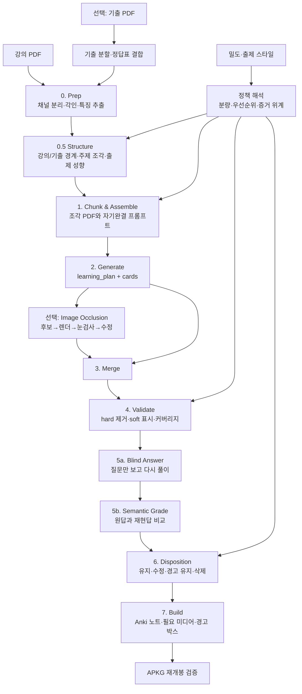

# PDF → Anki 출제 철학과 이식용 아키텍처

이 문서는 `quiz2` 프로젝트에서 재사용할 가치가 있는 두 부분만 추린다.

1. 어떤 지식을 어떤 카드로 만들 것인가에 관한 **출제 철학**
2. 강의 PDF와 기출 자료를 검증 가능한 Anki 덱으로 바꾸는 **파이프라인 아키텍처**

현재 저장소의 실행 명령, 특정 에이전트 런타임, 계측 코드, 과거 v1 호환성은 이식 대상에서 제외한다. 구현의 주된 근거는 `quiz2/prompt.py`, 단계별 구현은 `quiz2/prep.py`부터 `quiz2/build.py`, 결정의 이유는 `quiz2/INTERVIEW.md`, 실측 결과는 `quiz2/RUNS.md`다.

---

## 1. 한 문장으로 요약

**코드는 자료를 정규화하고 범위·스키마·기계적 오류를 책임지며, 모델은 학습 목표·문항 선택·의미 판단을 책임진다. 질문만으로 답이 재현되는지 다시 풀어 본 뒤, 각 카드를 유지·수정·경고 유지·삭제 중 하나로 판정해 회수 가치가 높은 덱만 남긴다.**

이 분업이 이 프로젝트의 가장 중요한 설계 원칙이다.

---

## 2. 출제 철학

### 2.1 목적 함수: 시험 점수는 이해와 암기의 합이다

- 덱의 목적 함수는 **시험 점수**다.
- 이때 시험 점수는 별도의 단일 능력이 아니라 **이해 + 암기**로 구성된다.
- 따라서 “무엇인가”를 묻는 암기 카드와 “왜 그런가”를 묻는 이해 카드 모두 필요하다.
- 기출에 직접 나오지 않았더라도 강의의 핵심 기전이나 구분 원리를 묻는 카드는 가치가 있다.
- 기출은 정답지가 아니라 다음 두 목적의 **중요한 길잡이**다.
  - 같은 문제가 다시 나올 가능성을 반영한다.
  - 교수가 무엇을 중요하게 보는지 추론한다.

이식판의 정본 표현은 **“목적 함수는 시험 점수이며, 시험 점수는 이해와 암기의 합이다”**로 한다. 이해를 시험 점수와 경쟁하는 별도 목표로 두지 않으며, 암기를 이해보다 낮은 단계로 취급하지도 않는다.

### 2.2 사용 방식이 분량을 결정한다

이 덱은 무한 SRS만을 가정하지 않는다. 기본 사용은 다음 세 번의 회독이다.

1. 강의 직후
2. 다음날 또는 주말
3. 시험 직전

쉬운 카드는 빠르게 사라지고 어려운 카드만 3~5회 반복된다. 따라서 지나친 최소화보다 시험 가능한 내용을 충분히 담되, 회수 가치가 낮은 카드를 분량을 맞추기 위해 억지로 만들지 않는다.

기본 기준 분량은 다음과 같다.

```text
기본 목표 카드 수 = 강의 슬라이드 수 + 50
```

이 값은 기출 조각의 페이지 수가 아니라 **강의 슬라이드 수**를 기준으로 계산한다. 목표는 생성 모델이 저가치 카드를 억지로 채우게 하는 하드 쿼터가 아니라, 검증 단계에서 실제 분량을 비교하는 운영 기준이다.

### 2.3 밀도와 출제 스타일은 서로 다른 설정이다

`density`는 **얼마나 많이 낼지**, `style`은 **무엇을 우선해 낼지**를 정한다. 두 설정을 하나의 프롬프트 문장이나 프로필 이름으로 합치지 않는다.

#### 밀도

| 값 | 의미 | 분량 정책 |
|---|---|---|
| `concise` | 가장 중요한 회수 목표만 압축 | 기본 목표보다 적게 나올 수 있다 |
| `normal` | 핵심과 시험 가능한 세부를 균형 있게 포함 | **슬라이드 수 + 50**을 기준 목표로 삼는다 |
| `exhaustive` | 예외·세부·표와 그림의 포인트까지 넓게 포함 | 기본 목표보다 많게 나올 수 있다 |

`concise`와 `exhaustive`의 숫자 배수는 근거 없이 고정하지 않는다. 우선 선택 정책으로 동작시키고, 실제 생성량과 회독 시간을 측정한 뒤 별도 `VolumePolicy`로 수치화한다.

#### 출제 스타일

| 값 | 표시 이름 | 우선순위 | 증거 정책의 변화 |
|---|---|---|---|
| `default` | 기본 | 강의 구조, 기출, 필기, 표·그림을 균형 있게 반영 | 필기는 중요도 신호 |
| `jokbo_focused` | 족보 중심 | 실제 기출 문항, 반복 개념, 반복 선지를 우선 | 기출은 근거, 필기는 중요도 신호 |
| `annotation_focused` | 필기 중심 | 필기·형광펜·도장이 가리키는 내용과 필기 고유 내용을 우선 | **필기를 강의록과 동급 근거로 승격** |
| `lecture_focused` | 강의록 중심 | 강의록 본문 구조, 정의, 비교, 기전, 요약을 우선 | 필기와 기출은 선택·우선순위 신호 |
| `figure_focused` | 그림 중심 | 사진, 조직학, 그래프, 표, 모식도와 위치·형태 회상을 우선 | 그림·표 근거와 시각 카드 비중을 높임 |

스타일은 닫힌 enum으로 시작하되 추가 스타일을 등록할 수 있게 한다. 어떤 스타일도 grounding, 자족성, 카드 스키마, hard validation을 우회할 수 없다.

`annotation_focused`는 단순히 필기 카드를 많이 만드는 옵션이 아니다. 이 스타일을 선택하면 `EvidencePolicy.annotation_mode`가 자동으로 `equal_to_lecture`가 되고, annotated 채널과 annotation notes를 모든 관련 조각에 제공한다. 다른 스타일의 기본값은 `signal_only`다.

### 2.4 좋은 카드의 최상위 기준은 답의 재현 가능성이다

좋은 카드는 질문만 본 독립적인 풀이자가 제작자가 의도한 답과 의미상 같은 답을 낼 수 있어야 한다.

- 질문과 답이 직접 연결되어야 한다.
- 질문은 원본 슬라이드 없이도 무엇을 묻는지 이해할 수 있어야 한다.
- 정답의 핵심 단서를 질문에 노출하지 않는다.
- 답은 핵심만 두고 부연과 이유는 해설로 내린다.
- 답이 열린 부분집합이면 요구 개수를 질문에 밝힌다.
- 분류처럼 답의 집합이 닫혀 있으면 개수를 굳이 밝히지 않아도 된다.

예:

```text
나쁨  Q. A와 B의 차이는?              A. 우성/열성
좋음  Q. A와 B를 가르는 네 가지는?   A. 유전 양식, 형태, 침범 부위, 발병 시기
```

이 기준은 문자열 길이, 물음표 수 같은 대리 지표보다 **실제로 다시 풀어 보는 전수 재현 검사**로 측정한다.

### 2.5 한 카드는 하나의 의미 있는 회상 행위를 평가한다

- 같은 사실이 본문·표·그림에 반복되어도 같은 회상 방향이면 한 장만 만든다.
- 그렇다고 단어 단위로 과도하게 원자화하지 않는다.
- 같은 구조나 범주에 속하고 자료에서 함께 제시된 항목은 한 카드에 묶을 수 있다.
- 목록·순서·O/X 선지는 한 번에 회수해야 할 항목이 너무 많아지면 나눈다. 현재 구현의 경계는 6개다.
- 양방향 카드는 실질적인 일대일 대응이고 양쪽 모두 시험 가치가 있을 때만 만든다.
- 같은 개념도 회상 방향이 다르면 별도 카드가 될 수 있다. 문자열 유사도만으로 삭제하지는 않지만, **같은 회상 방향의 의미 중복**으로 확인되면 한 장만 남긴다.

### 2.6 먼저 학습 목표를 세우고, 카드화하지 않은 것도 기록한다

각 자료 조각은 카드보다 먼저 `learning_plan`을 만든다.

후보 지식은 다음 기준으로 평가한다.

- 개념적 중심성
- 헷갈리는 대상을 구분하는 힘
- 상식만으로 맞힐 수 없는 비자명성
- 새 문제에 적용할 수 있는 전이 가능성
- 반복·요약·강조로 드러난 교육적 중요도

학습 목표는 “이해한다” 같은 추상 표현이 아니라 “식별한다”, “구분한다”, “설명한다”, “적용한다”, “재구성한다”처럼 검증 가능한 회수 목표로 쓴다.

검토했지만 카드로 만들지 않은 후보도 `rejected_candidates`에 남긴다. 이는 완전성을 강제하기 위한 것이 아니라, **누락과 의도적 제외를 구분하는 감사 흔적**이다.

### 2.7 근거는 엄격하게, 해설은 유연하게

질문과 정답은 자료에서 직접 확인되어야 한다.

허용 근거:

- 본문
- 표의 제목·행·열·셀
- 그림의 명시적 라벨·범례·축·화살표·연결선
- 같은 조각 안에서 명시적으로 이어지는 슬라이드

금지되는 추론:

- 외부 지식으로 빠진 기전이나 임상적 의미를 메우기
- 가까이 놓인 요소만 보고 결합·활성화·억제·인과를 추론하기
- 병렬 경로를 필수 순차 경로로 재구성하기
- 조밀한 개요 그림의 작은 라벨을 무차별 카드화하기

자료에 없는 보충 설명은 `explanation`에 둘 수 있지만 `q`와 `a`의 근거가 되어서는 안 된다.

### 2.8 자료 채널의 위계를 명시한다

기본 정책은 다음과 같다.

| 채널 | 기본 역할 | 질문·정답의 근거 |
|---|---|---|
| Clean PDF | 필기를 제거한 인쇄 자료 | 가능 |
| Annotated PDF | 필기·형광펜·도장으로 나타난 중요도 신호 | 기본적으로 불가 |
| Annotation notes | 필기 문구와 표시가 덮은 텍스트 | 기본적으로 불가 |
| 기출 원문 | 실제 출제 여부와 기출 카드의 근거 | 가능 |
| 기출 요약 | 교수의 출제 성향과 우선순위 | 직접 근거가 아니라 선택 신호 |

기본 예외는 **인쇄 자료에는 없지만 필기에만 있고, 기출이 그 지점을 실제로 물은 경우**다. 이때 필기를 근거로 인정한다.

`annotation_focused` 스타일에서는 필기와 annotation notes를 인쇄 자료와 동급 근거로 승격한다. 채널 정책은 반드시 `EvidencePolicy` 한 곳에서 정의하고, 프롬프트 조립기·입력 첨부기·validator가 같은 값을 읽어야 한다. 현재 구현처럼 `prompt.annotation_section()`과 `chunks.HIERARCHY`가 각자 위계를 설명하게 두면 서로 충돌할 수 있다.

### 2.9 표와 그림은 구조를 먼저 읽는다

- 표와 그림을 셀·라벨의 집합이 아니라 정의·분류·비교·경향·예외·기준값·기전의 구조로 읽는다.
- 개별 값은 그 구조를 이해하거나 항목을 구분하는 데 기여할 때만 묻는다.
- 수치는 분류·판단·비교·결론을 가를 때만 회상 대상으로 삼는다.
- 여러 항목이 하나의 결론을 받치면 임의의 일부보다 공통 구조와 대표 항목을 묻는다.
- 텍스트로 바꾸면 위치·형태 정보가 사라지는 사진, 조직학, 지도, 그래프, 모식도는 이미지 카드로 낸다.

### 2.10 질문은 자료를 가리키지 않고 내용 자체로 선다

일반 텍스트 카드에서 다음과 같은 표현을 피한다.

- 이것, 위 그림, 해당 물질
- 표에 제시된, 슬라이드에 따르면
- 강의록이 든, 본문에 따르면
- 필기된, 강조된, 도장이 찍힌

이미지가 실제 앞면에 붙는 오클루전 카드는 예외다. 이때는 “A로 표시된 구조의 이름은?”처럼 이미지 안의 표식을 가리킬 수 있다.

### 2.11 기출은 우선순위 신호이자 별도 카드 소스다

- 강의록 카드는 특정 연도·문항이 같은 회수 목표를 실제로 물었을 때만 `exam_hit=true`로 둔다.
- 주제만 비슷하거나 출제 성향 요약에만 나온 경우는 `exam_hit`이 아니다.
- 기출 카드는 `source_type=jokbo` 자체로 구분하므로 `exam_hit`을 중복 부여하지 않는다.
- 지엽적인 기출도 후보에서 처음부터 배제하지 않고 `importance=detail`로 평가한다. 다만 같은 회상 방향의 중복이거나, 현재 강의 범위와 무관하거나, 회수 가치가 현저히 낮으면 삭제할 수 있다.
- 기출 문항은 개념형, 원문형, 반복 선지 O/X 묶음 중 성격에 맞는 형식을 고른다.
- 기출 정답은 오류 가능성이 있으므로 외부의 확립된 지식으로 독립 검토한다. 불일치나 문항 오류를 발견하면 근거를 기록한 뒤 수정·경고 유지·삭제 중 하나를 명시적으로 고른다. 근거 없이 조용히 바꾸는 것만 금지한다.

### 2.12 의심 신호는 삭제 판단의 입력이다

시스템이 발견한 문제는 세 부류로 나뉜다.

| 신호 | 의심 대상 | 가능한 판정 |
|---|---|---|
| 족보 검토 | 기출 정답 또는 문항 | 수정, 경고 유지, 삭제 |
| 재현 주의 | 카드의 질문-답 연결 | 질문 수정, 경고 유지, 삭제 |
| 자료 주의 | 원본 자료 자체 | 경고 유지, 회상 방향 변경, 삭제 |

신호 하나만으로 기계적으로 일괄 삭제하지는 않는다. 대신 다음 세 경로로 처리한다.

1. **자동 삭제** — 내용 판단이 필요 없는 명백한 결함
   - 빈 질문·빈 답
   - 깨져서 복구할 수 없는 스키마나 좌표
   - 범위 밖 슬라이드
   - 질문과 답이 같은 카드
   - 완전히 같은 카드의 후속 사본
2. **검토 후 삭제** — 의미 판단이 필요한 저가치 카드
   - 같은 회상 방향의 의미 중복
   - 자료 근거가 없는 생성 내용
   - 너무 자명하거나 장식적인 내용
   - 질문을 한 번 고쳐도 답이 좁혀지지 않는 모호한 카드
   - 출제 스타일과 강의 범위에서 벗어난 카드
   - 지나친 원자화로 따로 외울 가치가 없는 파편
3. **경고 후 유지** — 결함 신호가 있어도 회수 가치가 큰 카드
   - 실제 기출이 같은 지점을 물은 카드
   - 강의 고유의 수치·표 값이라 외부 풀이자가 재현하기 어려운 카드
   - 원본 자료의 모순 자체를 알아야 하는 카드
   - 시각 자료가 있어야만 성립하는 유효한 그림 카드

따라서 재현 실패도 삭제 가능하다. 다만 `different` 또는 `partial`이라는 판정만으로 삭제하지 않고, 중요도·기출 여부·근거 강도·수정 가능성을 함께 보고 결정한다.

경고 유지로 판정된 신호는 별도 리포트에만 두지 않고 카드 뒷면에 노출한다. 실제 사용자는 덱을 따로 감사하기보다 풀면서 거르기 때문이다.

### 2.13 목표 분량은 선별 삭제 단계에서 작동한다

생성 단계는 좋은 후보를 놓치지 않도록 기준 분량보다 다소 많이 낼 수 있다. 검증과 재현 검사 후 다음 순서로 우선순위를 매겨 낮은 카드부터 정리한다.

1. 실제 기출과의 직접 연결
2. 강의의 개념적 중심성
3. 질문-답의 재현 가능성
4. 다른 카드와 겹치지 않는 고유한 회상 가치
5. 선택한 출제 스타일과의 정합성
6. 자료 근거의 명확성

`normal`의 **슬라이드 수 + 50**은 이 선별 단계의 기준점이다. `concise`는 더 강하게 삭제하고 `exhaustive`는 세부 카드를 더 보존한다. 목표 수를 맞추기 위해 좋은 카드를 억지로 삭제하거나 저가치 카드를 채워 넣지는 않는다.

### 2.14 완전성은 감시하되 절대 목표로 만들지 않는다

- 빠짐없이 내는 데 집착하지 않는다.
- 그러나 카드가 없는 슬라이드와 회수 목표 누락은 계속 센다.
- 특히 카드도 없고 제외 기록에도 언급되지 않은 `untouched_undeclared`를 의미 있는 누락 신호로 본다.
- 누락 계수 자체가 카드를 자동 생성하거나 삭제하게 하지는 않는다.

---

## 3. 아키텍처의 핵심 원칙

### 3.1 코드와 모델의 책임을 분리한다

| 코드가 맡는 일 | 모델이 맡는 일 |
|---|---|
| PDF 정규화, 필기 제거, 이미지 렌더 | 학습 목표 추론 |
| 슬라이드 번호 각인과 범위 관리 | 카드 후보 선택과 회상 방향 결정 |
| 텍스트·표·라벨·주석 추출 | 자료 채널의 의미 해석 |
| 조각 PDF와 완성 프롬프트 조립 | 질문·답·해설 작성 |
| 스키마·enum·좌표·범위 검증 | 유사 카드가 실제 중복인지 판단 |
| 명백한 결함과 정확 중복 제거 | 의미 중복·저가치·모호한 카드의 삭제 판단 |
| 통계와 분량 목표 산출 | 기출 정오 검토와 의미상 동등성 채점 |
| Anki 미디어와 `.apkg` 생성·재검증 | 이미지 오클루전의 유효한 회수 목표 선택 |

모델이 규칙 파일과 입력 파일을 찾아다니게 하지 않는다. 코드가 **읽을 파일, 담당 범위, 전체 규칙, 출력 스키마**를 한 번에 조립해 전달한다.

### 3.2 판정의 정본을 명확히 한다

- 자료 구간과 조각 범위의 정본: `structure.json`
- 실행 입력과 렌더 자산의 정본: `prep.json`
- 출제 규칙의 정본: 버전 관리되는 프롬프트 모듈
- 카드 계약의 정본: 공용 스키마
- 기계 검증의 정본: validator
- 최종 사용자에게 전달되는 품질 신호의 정본: 카드의 구조화된 review 필드

정규식이나 휴리스틱은 힌트일 뿐이다. 모델의 구조 판정과 크게 어긋날 때 경고할 수는 있지만, 조용히 정본을 덮어쓰면 안 된다.

### 3.3 조용한 손실보다 시끄러운 실패를 택한다

실행 전체의 입력·출력 무결성이 깨진 경우는 파이프라인을 중단한다.

- 범위를 벗어난 PDF 자르기 또는 구조 전체의 잘못된 페이지 매핑
- 원본 PDF나 필수 manifest의 누락
- APKG에 포함돼야 할 미디어의 누락
- 최종 노트 수와 패키지 검증 결과의 불일치

반면 비어 있는 질문·답, 개별 카드의 범위 오류, 깨진 cloze, 풀리지 않는 오클루전 좌표는 해당 카드를 자동 삭제하고 원문과 사유를 기록한다. 자족성, 중요도, 유사 중복처럼 의미 판단이 필요한 문제는 soft flag로 선별 단계에 넘겨 유지·수정·경고 유지·삭제를 결정한다.

### 3.4 생성 설정은 먼저 해석해 하나의 정책으로 고정한다

사용자 입력은 다음처럼 저장한다.

```json
{
  "density": "normal",
  "style": "default",
  "volume": {
    "formula": "lecture_slides + 50"
  }
}
```

파이프라인 시작 시 이를 `ResolvedGenerationPolicy`로 해석한다.

```json
{
  "density": "normal",
  "style": "default",
  "target_cards": 117,
  "annotation_mode": "signal_only",
  "priority_channels": ["lecture", "jokbo", "annotation", "figure"]
}
```

예를 들어 67장 강의의 기본 목표는 117장이다. `style=annotation_focused`이면 `annotation_mode`는 항상 `equal_to_lecture`로 해석한다. 이후 모든 단계는 원래 사용자 입력을 제각각 해석하지 않고 이 resolved policy만 읽는다.

---

## 4. 전체 데이터 흐름



---

## 5. 단계별 계약

### 5.1 선택 전처리: 기출 원본 분할

입력:

- 과목 전체 기출 PDF

처리:

- 강의 또는 단원별 구간 탐지
- 문제 구간과 정답표 구간 분류
- 해당 문제 PDF 뒤에 정답표를 결합
- 강의 번호·제목·출력 파일을 색인화

출력:

- 강의별 기출 PDF
- `index.json`

이 모듈은 해당 학교의 기출 편집 형식에 강하게 결합되어 있다. 핵심 파이프라인에는 `ExamSourceAdapter` 인터페이스만 두고, 실제 분할기는 프로젝트별 플러그인으로 구현하는 것이 좋다.

### 5.2 Prep: 원본을 여러 증거 채널로 정규화

입력:

- 강의 PDF
- 선택적 기출 PDF

처리:

- 필기를 제거한 clean PDF 생성
- 원본 필기를 유지한 annotated PDF 생성
- 각 페이지에 안정적인 `Slide N` 라벨 각인
- 제목/개요, 주석, 라벨 좌표, 페이지 특징 추출
- 외부 기출이 있으면 강의 뒤의 연속 슬라이드 번호 공간에 연결

주요 출력:

- `prep.json`
- `model_input.pdf`
- `annotated.pdf`
- `outline.json`
- `annotations.json`
- `labels.json`
- `page_features.json`
- 선택적 `jokbo_text.md`

`media/*.png` 형태의 슬라이드 전체 사전 렌더 캐시는 이식 계약에 포함하지 않는다. 이미지 오클루전이나 그림 카드에 필요한 미디어만 해당 단계에서 원본 PDF로부터 렌더한다.

핵심 불변식은 **슬라이드 번호, 원본 PDF 페이지, 라벨 좌표가 같은 논리 슬라이드를 가리킨다**는 것이다.

### 5.3 Structure: 의미적 경계는 모델이 정하고 코드는 검증한다

입력:

- 슬라이드 제목·첫 줄 표
- 페이지별 텍스트량, 답안 행, 기출 키워드, 이미지 비율 등의 특징
- 기계가 계산한 경계 힌트
- 필요한 최소 원본 구간
- 선택적 기출 원문

모델 출력:

```json
{
  "lecture_range": [1, 67],
  "jokbo_range": [68, 89],
  "jokbo_evidence": "경계 판단 근거",
  "chunks": [
    {
      "id": "c01",
      "title": "주제명",
      "slides": [1, 8],
      "summary": "이 조각의 역할"
    }
  ],
  "exam_focus": {
    "summary": "교수의 출제 성향"
  }
}
```

코드 검증:

- 강의와 기출 범위가 겹치거나 비지 않는가
- 모든 강의 슬라이드가 정확히 한 조각에 속하는가
- 조각 크기가 입력 도구의 페이지 상한을 넘지 않는가
- 기출 경계가 페이지 특징과 심하게 모순되지 않는가

`structure.json`이 이후 모든 범위 판정의 정본이다.

### 5.4 Chunk & Assemble: 모델이 탐색하지 않도록 입력을 완제품으로 만든다

각 조각마다 다음을 만든다.

- clean 조각 PDF
- 필요한 경우 annotated 조각 PDF
- 해당 범위의 annotation notes
- 담당 슬라이드 범위
- 출제 철학 전문
- 해석이 끝난 밀도·출제 스타일·증거 정책
- 기출 성향 요약
- 출력 JSON 스키마와 허용 enum
- 정확한 출력 경로

생성 모델의 출력 계약:

```json
{
  "learning_plan": [
    {
      "objective": "검증 가능한 학습 목표",
      "retrieval_targets": ["회수할 지식"],
      "rejected_candidates": [
        {
          "candidate": "검토했지만 제외한 후보",
          "reason": "decorative"
        }
      ]
    }
  ],
  "cards": [
    {
      "q": "질문 또는 cloze 문장",
      "a": "핵심 정답",
      "explanation": "왜 이 답인지",
      "slide_no": 12,
      "card_type": "fact",
      "card_format": "basic",
      "importance": "core",
      "exam_hit": false,
      "evidence_type": "lecture_text",
      "source_type": "lecture",
      "review_note": null
    }
  ]
}
```

권장 enum:

- `card_type`: `fact | comparison | mechanism | trap | list | sequence`
- `card_format`: `basic | cloze | ox`
- `importance`: `core | detail`
- `source_type`: `lecture | jokbo`
- 강의 카드의 `evidence_type`: `lecture_text | table | figure | annotation`
- 기출 카드의 `evidence_type`: `question_text | table | figure`

스키마는 프롬프트 산문 속에만 두지 말고 JSON Schema 또는 타입 정의로 분리해 validator와 builder가 함께 사용해야 한다.

### 5.5 Image Occlusion: 시각 카드만 별도 반복 패스로 처리

오클루전은 렌더 결과를 눈으로 확인해야 하므로 일반 카드의 단발 생성과 분리한다.

두 카드 형식을 지원한다.

1. `crop`: 사진·조직학·육안 소견을 잘라 “이 그림이 무엇인가”를 묻는다.
2. `mask`: 라벨이나 영역을 가려 위치와 이름의 대응을 묻는다.

권장 흐름:

1. 코드가 큰 래스터 또는 넓은 벡터 도형이 있는 슬라이드를 후보로 올린다.
2. 코드가 라벨 ID와 좌표가 표시된 지도를 렌더한다.
3. 모델이 회수 가치가 있는 그림만 고르고 `crop` 또는 `label_ids`를 지정한다.
4. 코드는 가린 앞면과 드러낸 뒷면을 렌더한다.
5. 접촉 시트로 상자 누락·과다 가림·정답 누출을 눈으로 확인한다.
6. 문제가 있으면 이 단계 안에서만 반복 수정한다.

코드가 검사할 수 있는 항목:

- 가린 답이 다른 라벨에 그대로 노출되는가
- 가린 답이 필기 텍스트에 그대로 노출되는가
- 직접 지정한 사각형이 라벨 일부만 걸치는가
- 좌표와 라벨 ID가 실제 페이지에서 풀리는가

이미지 카드의 앞면에는 이미지가 필수이므로 텍스트 질문만 사용하는 재현 검사에서는 제외한다.

### 5.6 Merge: 조각 결과를 합치되 판단은 하지 않는다

처리:

- 조각별 카드를 하나의 `items.raw.json`으로 병합
- 안정적인 카드 ID 부여
- `learning_plan`을 `plan.json`으로 보존
- 조각 경계를 넘어 같은 슬라이드를 사용한 경우 중복 후보로 표시

이 단계는 콘텐츠를 수정하지 않는다.

### 5.7 Validate: 명백한 오류만 차단하고 나머지는 표시한다

Hard failure 예:

- 질문 또는 답이 비어 있음
- 질문과 답이 동일함
- 슬라이드 번호가 없거나 전체 범위 밖임
- cloze 문법이 깨짐
- 오클루전 객체·좌표·라벨 ID가 유효하지 않음
- 정확히 같은 카드가 중복됨

Soft flag 예:

- 조각 범위 밖의 슬라이드를 참조함
- `card_format`과 cloze/OX 표현이 맞지 않음
- 자료 자체를 가리키는 질문
- 정답 단서가 질문에 노출됨
- 해설·메타데이터가 누락됨
- 필기 근거 정책과 맞지 않음
- 강의 카드와 기출 카드의 범위가 뒤바뀜
- 유사 중복 후보
- 회수 목표 누락, 아무도 언급하지 않은 슬라이드

산출물:

- `items.checked.json`: hard 검사를 통과한 카드
- `suspects.json`: 제거 원문, soft flag, 통계, 유사 후보, 커버리지 신호

validator는 의미적 결론을 대신하지 않는다. 유사 중복, 자족성, 중요도 문제는 삭제 후보로 표시하고 뒤의 disposition 단계가 판정한다.

### 5.8 Reproduce: 질문만 주고 다시 풀어 본다

1단계 — Blind answer:

- 풀이 모델에는 `id`, 실제 앞면 텍스트, `card_format`만 준다.
- `a`, `explanation`, `slide_no`, 원본 PDF를 주지 않는다.
- cloze 정답은 실제 Anki처럼 가린다.
- 질문 자체가 성립하지 않으면 `answerable=false`로 표시한다.

2단계 — Semantic grade:

- 별도 채점 모델에 질문, 원래 답, 재현 답을 준다.
- 표기·어순·한영 차이를 허용해 의미상 비교한다.
- 결과는 `same | partial | different`다.
- 원래 답의 의학적 정오가 아니라 **두 답의 동등성**만 판단한다.

3단계 — Apply:

- 결과를 구조화된 `reproduce` 객체로 카드에 붙인다.
- `review_note` 문자열에 합치지 않는다.
- 실패 카드를 disposition 단계의 우선 검토 대상으로 보낸다.

### 5.9 Disposition: 유지·수정·경고 유지·삭제를 명시적으로 판정한다

입력:

- hard 검사를 통과한 카드
- soft flag와 중복 후보군
- 재현 검사 결과
- `ResolvedGenerationPolicy`
- 목표 카드 수

각 카드의 최종 판정은 다음 네 값 중 하나다.

```json
{
  "id": "q042",
  "action": "drop",
  "reason": "semantic_duplicate",
  "evidence": ["q017과 같은 회상 방향"],
  "replacement_id": "q017"
}
```

- `keep` — 그대로 유지
- `revise` — 질문·답·메타데이터를 고친 뒤 재검증
- `keep_with_warning` — 유지하고 카드 뒷면에 신호 표시
- `drop` — 최종 덱에서 삭제

권장 삭제 사유 enum:

- `exact_duplicate`
- `semantic_duplicate`
- `unsupported`
- `out_of_scope`
- `obvious_or_decorative`
- `ambiguous_unrepairable`
- `over_fragmented`
- `style_mismatch`
- `invalid_unrepairable`

`revise`된 카드는 validator와 필요한 경우 재현 검사를 다시 통과해야 한다. 모든 `drop`은 원문 카드와 삭제 근거를 `disposition.json`에 남겨 과삭제를 감사할 수 있게 한다.

삭제 후에는 `learning_plan` 커버리지를 다시 계산한다. `core` 학습 목표를 회수하는 마지막 카드라면, 그 목표 자체를 제외하기로 명시하지 않는 한 단순 분량 조절만으로 삭제하지 않는다. 중복 카드를 합칠 때도 남은 한 장이 원래 회수 목표를 충분히 덮는지 확인한다.

산출물:

- `items.final.json`: `keep`과 `keep_with_warning`, 재검증을 통과한 `revise` 카드
- `disposition.json`: 전체 카드의 판정과 삭제·수정 근거

### 5.10 Build: 학습 화면까지가 품질 파이프라인이다

빌드는 `items.final.json`만 입력으로 받아 다음을 책임진다.

- `basic`, `cloze`, `ox`, 오클루전 앞면 렌더
- 강의/기출 하위 덱 분리
- 그림 카드와 오클루전에 실제로 필요한 미디어만 원본 PDF에서 렌더해 포함
- 중요도·형식·출처·강의·슬라이드 태그 생성
- 족보 검토, 재현 주의, 자료 주의를 서로 다른 머리글로 카드 뒷면에 표시
- 정답 → 경고 → 선택적 시각 근거 → 접힌 해설·출처 순서 유지
- `.apkg`를 다시 열어 노트 수와 미디어 파일을 검증

일반 텍스트 카드를 위해 슬라이드 전체 PNG를 미리 만들거나 `media/*.png`를 유지하지 않는다. 시각 미디어가 필요하지 않은 카드는 PDF 페이지 참조 메타데이터만 가진다.

생성 라이브러리가 성공을 반환했다는 사실만으로 빌드 성공으로 간주하지 않는다.

---

## 6. 이식할 때의 권장 모듈 경계

```text
pdf_to_anki/
  domain/
    models.py              Card, LearningPlan, Structure, ReviewSignal
    schemas/               JSON Schema 또는 Pydantic 모델
    policies.py            GenerationPolicy, EvidencePolicy, VolumePolicy, StylePolicy
  adapters/
    lecture_pdf.py         PDF 추출·채널 분리
    exam_source.py         프로젝트별 기출 분할/연결
    anki.py                APKG 생성과 재검증
    model_gateway.py       생성·풀이·채점·선별 모델 호출 추상화
  pipeline/
    prep.py
    structure.py
    assemble.py
    generate.py
    occlusion.py
    merge.py
    validate.py
    reproduce.py
    disposition.py
    build.py
  prompts/
    philosophy.md
    structure.md
    cards.md
    occlusion.md
    reproduce_answer.md
    reproduce_grade.md
    disposition.md
  tests/
    fixtures/
    test_contracts.py
    test_pipeline_smoke.py
    test_apkg.py
```

핵심은 `domain`이 PDF 라이브러리, 특정 모델, Anki 패키지에 의존하지 않게 만드는 것이다.

---

## 7. 핵심·선택·프로젝트 종속 구분

### 반드시 이식할 핵심

- clean/annotated 증거 채널 분리
- 안정적인 슬라이드 ID와 manifest
- `structure.json`을 범위의 정본으로 삼는 구조화 단계
- 조각별 자기완결 프롬프트 조립
- `learning_plan`과 제외 기록
- 카드 공용 스키마와 enum
- `슬라이드 수 + 50` 기본 분량 정책
- `concise | normal | exhaustive` 밀도 설정
- 출제 스타일과 필기 중심의 증거 승격 규칙
- hard/soft가 분리된 validator
- 질문만으로 다시 푸는 재현 검사
- 유지·수정·경고 유지·삭제를 기록하는 disposition 단계
- 구조화된 경고를 카드 뒷면에 노출
- APKG 재개봉 검증

### 필요에 따라 이식할 선택 기능

- 이미지 오클루전
- 기출 원문 카드와 O/X 묶음
- 교수 맞춤 자유 지침
- 강의/기출 하위 덱 분리

### 새 프로젝트에 맞게 다시 구현할 부분

- 기출 PDF의 제목·답안표 탐지 휴리스틱
- 한국 의대 강의 자료에 맞춘 용어와 enum
- 특정 에이전트의 페이지 읽기 상한에 따른 조각 크기
- `concise`와 `exhaustive`의 구체적인 분량 수치
- `genanki` 노트 디자인과 덱 이름
- 현재 프로젝트의 파일명·강의 ID 규칙
- 에이전트 스폰, 토큰, 시간 계측 코드

---

## 8. 그대로 이식하면 안 되는 것

### 8.1 문서와 런타임 규칙의 충돌

현재 저장소를 이식판의 새 정책과 대조하면 적어도 세 충돌 또는 누락이 있다.

1. 목적 함수는 단순한 “시험 점수” 또는 “점수와 이해”의 병렬 목표가 아니라 **시험 점수 = 이해 + 암기**로 다시 정의됐다.
2. `annotation_focused`는 필기를 강의록과 동급 근거로 올려야 하지만, 현재 `chunks.HIERARCHY`는 clean만 근거라고 말할 수 있다.
3. 열린 답의 부분집합을 물을 때만 개수를 밝힌다는 최종 결정은 인터뷰에는 있지만 현재 카드 생성 프롬프트에는 명시적으로 반영되지 않았다.

이식판에서는 철학 문서, 프롬프트, validator가 동일한 정책 객체에서 파생되도록 만들어야 한다.

### 8.2 근거 없는 문자열 길이 제한과 과도한 계수기

과거의 질문·답 길이 한도, 복합 질문 정규식, hot slide 같은 계수기는 재현 실패를 잘 예측하지 못해 제거됐다. 이를 “안전장치가 빠졌다”고 보고 되살리지 않는다. 새 검사는 실제 실패 사례와 측정값이 있을 때만 추가한다.

### 8.3 재현 실패의 기계적 일괄 삭제

재현 실패 카드는 삭제할 수 있다. 다만 강의 고유 정보 때문에 외부 풀이자가 못 맞힌 카드와 질문 자체가 망가진 카드를 구분해야 한다. `partial`·`different`만으로 일괄 삭제하지 말고, 한 차례 수정해도 모호하거나 근거·고유 회상 가치가 낮을 때 `drop`한다.

### 8.4 모델에게 저장소 탐색을 맡기는 구조

모델이 규칙, 스키마, PDF, 라벨 파일을 직접 찾아다니게 하면 호출 수와 문맥 비용이 커지고 조각 간 동작이 달라진다. 이 프로젝트가 얻은 가장 큰 구조적 개선은 **프롬프트 조립을 코드로 되돌린 것**이다.

### 8.5 프롬프트 안에 계약과 판단 규칙을 뒤섞는 구조

OX 선지 형식이나 제외 사유 enum처럼 기계적 계약이 산문 속에만 있으면, 출제 규칙을 줄이는 실험에서 계약까지 함께 사라진다. 계약은 스키마로, 출제 판단은 정책 프롬프트로 분리한다.

---

## 9. 이식 순서

1. `Card`, `Structure`, `LearningPlan`, `ReviewSignal` 스키마를 먼저 정의한다.
2. 밀도·출제 스타일을 `ResolvedGenerationPolicy`로 해석하는 설정 계층을 구현한다.
3. 강의 PDF 한 편을 clean/annotated/manifest로 만드는 prep 어댑터를 구현한다.
4. 사람이 쓴 `structure.json` 한 개로 chunk→generate→merge를 먼저 관통시킨다.
5. hard/soft validator를 붙인다.
6. 구조 판정 모델을 붙이고, 코드가 범위의 완전성과 비겹침을 검증하게 한다.
7. blind answer와 semantic grade를 분리한 재현 검사를 붙인다.
8. disposition 단계에서 유지·수정·경고 유지·삭제와 근거를 기록한다.
9. 최종 카드만 빌드하고 APKG 재개봉 검증을 붙인다.
10. 경고가 실제 카드 뒷면에서 보이는지 확인한다.
11. 필요할 때만 기출 어댑터와 오클루전을 추가한다.

이 순서라면 이미지 오클루전이나 기출 형식에 막히지 않고 핵심 PDF→Anki 경로를 먼저 검증할 수 있다.

---

## 10. 최소 수용 테스트

이식 완료 기준은 다음과 같다.

- 모든 카드의 `slide_no`가 실제 원본 PDF 페이지와 연결된다.
- 일반 텍스트 카드만 있는 실행에서는 `media/*.png`가 생성되지 않는다.
- `normal` 밀도의 목표 카드 수가 `강의 슬라이드 수 + 50`으로 계산된다.
- 모든 출제 스타일이 동일한 카드 스키마와 hard validation을 사용한다.
- `annotation_focused`에서는 기출 연결이 없는 필기 고유 내용도 강의록과 동급 근거로 허용된다.
- 강의 범위의 모든 슬라이드가 정확히 한 chunk에 속한다.
- 실행 전체의 입력·출력 무결성을 깨는 hard failure가 있으면 빌드를 중단한다.
- 자동 삭제 사유의 카드는 최종 덱에서 제외되고 원문과 사유가 보존된다.
- soft flag가 있는 카드는 disposition 기록 없이 삭제되지 않는다.
- 같은 회상 방향의 의미 중복은 하나만 최종 덱에 남는다.
- `revise` 카드는 validator와 필요한 재현 검사를 다시 통과한다.
- `items.final.json`의 카드 수가 선택한 밀도와 목표 분량에 맞게 선별된다.
- cloze 답이 blind-answer 입력에 노출되지 않는다.
- blind-answer 입력에 답·해설·슬라이드 번호가 포함되지 않는다.
- 의미상 같은 영문/한글 답을 `same`으로 채점할 수 있다.
- 기출 카드에 `exam_hit`이 중복 부여되지 않는다.
- 세 종류의 경고가 카드 뒷면에서 서로 다른 머리글로 보인다.
- 오클루전 카드의 앞면과 뒷면 미디어가 모두 패키지에 존재한다.
- 완성된 `.apkg`를 다시 열었을 때 기대한 노트 수와 미디어 수가 일치한다.

---

## 11. 최종 이식 판단

이 프로젝트에서 가져갈 것은 거대한 프롬프트가 아니라 다음 네 가지다.

1. **근거 채널의 위계** — 무엇이 사실 근거이고 무엇이 우선순위 신호인지 분리한다.
2. **코드/모델 책임 분리** — 코드는 계약과 검증, 모델은 의미 판단을 맡는다.
3. **재현 가능성이라는 실행 가능한 품질 기준** — 좋은 문장처럼 보이는지를 넘어 실제로 다시 풀어 본다.
4. **근거 있는 선별과 인간-루프** — 저가치·중복·복구 불가능 카드는 삭제하고, 가치 있는 불확실성만 경고와 함께 학습 화면에 전달한다.

이 네 가지를 유지하면 PDF 파서, 모델 제공자, 기출 형식, Anki 템플릿이 달라져도 같은 철학의 시스템으로 이식할 수 있다.
