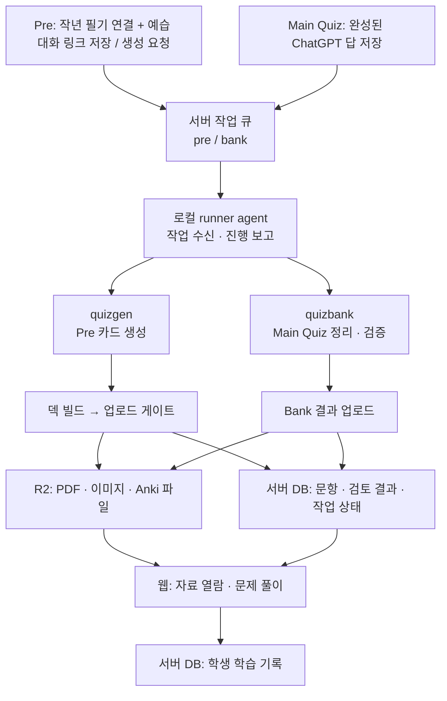
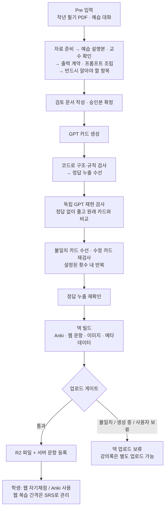
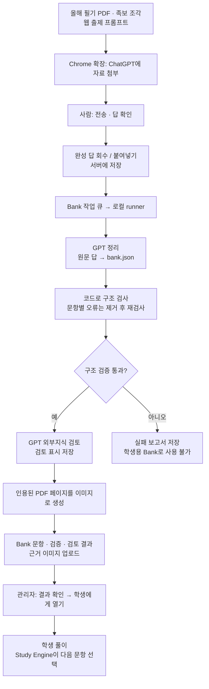

# 현재 파이프라인 도식

Main Quiz는 Quizbank 문제은행, Pre는 quizgen 예습 카드다.
2026-10-06부터 기존 quizgen Main 생성은 중단하고 카드·덱·학습 기록은 보관한다.
아래는 운영 러너를 통한 흐름이다. 직접 CLI로 생성하면 서버의 작업 큐를 건너뛴다.
Spotter의 사진 자료 관리는 별도 흐름이다.

## 1. 전체 흐름: 서버가 접수하고 로컬 PC가 생성한다

- **로컬 PC**: 자료 탐색, PDF 처리, GPT 호출, 산출물 생성. PC가 자거나 러너가 꺼지면 생성이 멈춘다.
- **서버**: 작업 큐, 권한 확인, 문항·학습 기록 저장, 파일 접근 URL 발급.
- **R2**: 파일 저장. 러너는 서버가 발급한 서명 URL로 파일을 직접 업로드한다.
- **웹**: 관리자 요청·검토·공개와 학생 풀이. Bank는 관리자 공개가 추가로 필요하다.

## 2. Pre-Quiz: 카드 생성·검증·배급

GPT 호출은 `studyez_llm/codex.py`를 공통으로 사용한다. 현재 기본 모델은
`gpt-6.1-sol`이며 설정은 [GPT 실행 설정](quizgen.md#gpt-실행-설정)에 있다.
독립 재현 검사는 출제 세션의 정답·맥락을 넘겨받지 않는다.

기본 실행은 검토 문서를 만든 뒤 승인본을 자동으로 확정한다. 사람이 먼저 검토하려면
`--stop-at-review`로 멈추고 수정한 뒤 재개한다. Pre는 재현 검사를 생략하는 옵션도 있지만,
도식은 기본 실행을 나타낸다.

덱 파일이 만들어졌다고 모든 카드가 무결하거나 공개된 것은 아니다. 카드 결함 표시는
검토 대상으로 남을 수 있고, 업로드 게이트는 선택한 실행 시도·파일·메타데이터·보류 표시의
일치를 확인한다.

## 3. Main Quiz (Quizbank): ChatGPT 출제 → 로컬 정리 → 관리자 공개

외부지식 검토는 문항에 검토 표시를 남긴다. 문항을 몰래 고치거나 그 결과만으로 자동 공개를
막는 단계는 아니다. 구조 검증 실패와 구별해서 읽는다.

Bank는 `runner/bank.py`에서 결과를 직접 업로드하며 Pre-Quiz의 덱 업로드 게이트를
통과하지 않는다. 작업이 끝났다는 상태도 검증 통과·학생 공개와 다르다.

## 4. 수정할 때 볼 코드

| 바꾸려는 부분 | 시작점 |
|---|---|
| 작업 접수·실행·재시도 | [서버 큐](../server/app/jobs/queue.py), [로컬 에이전트](../runner/agent.py) |
| Main 정리·검증 순서 | [quizbank/run.py](../quizbank/run.py) |
| Pre 생성 순서 | [quizgen/prequiz/run.py](../quizgen/prequiz/run.py) |
| GPT 실행 공통 설정 | [studyez_llm/codex.py](../studyez_llm/codex.py) |
| 덱 업로드 조건·배급 | [gate.py](../runner/gate.py), [publish.py](../runner/publish.py) |
| Bank 출제 입력·응답 접수 | [출제 프롬프트](../web/src/bank/bankPrompt.md), [Bank API](../server/app/routes/bank.py) |
| Bank 정리·검증·업로드 | [quizbank/run.py](../quizbank/run.py), [runner/bank.py](../runner/bank.py) |
| 학생 복습·다음 문제 선택 | [SRS](../server/app/srs.py), [Study Engine](../server/app/study_engine/) |

세부 데이터 계약은 [산출물 계약](artifact-contract.md), 실행 기록과 선택한 시도는
[runs 구조](runs-layout.md), 컴포넌트 책임은 [현재 구조](architecture.md)를 따른다.
